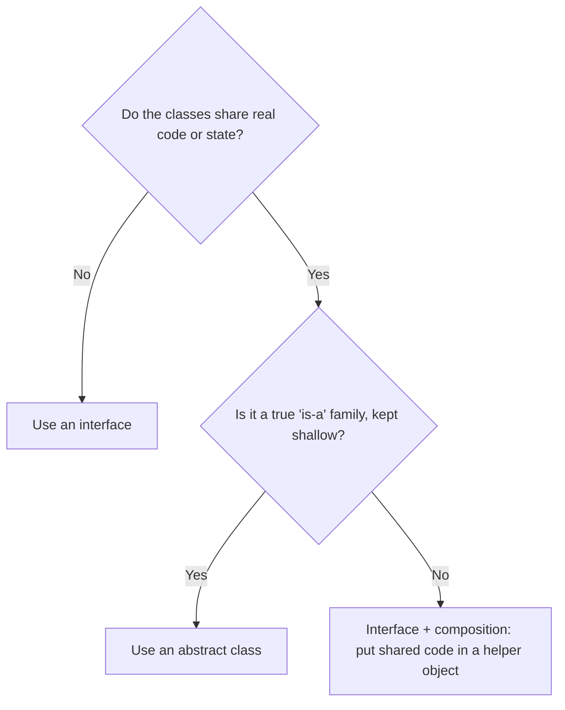

## The big idea

- An **interface** is like a **job description**: *"must be able to drive, must speak English."* It lists what's required but says nothing about how you learned to do it. Anyone who meets the requirements can take the job.
- An **abstract class** is like a **half-built house from a builder**: the walls, roof and plumbing are already done, and you finish the rooms your own way. You can't live in it until you've finished it.


## Interfaces

An interface describes the **shape** an object must have. It has **no code** and **no state**.

```ts
interface Notifier {
  send(to: string, message: string): Promise<void>;
}

interface Retryable {
  maxRetries: number;
}

// A class can implement MANY interfaces
class EmailNotifier implements Notifier, Retryable {
  maxRetries = 3;
  async send(to: string, message: string) {
    /* call email API */
  }
}

class SlackNotifier implements Notifier {
  async send(to: string, message: string) {
    /* post to Slack webhook */
  }
}

async function alertOnCall(notifier: Notifier) {
  await notifier.send("oncall", "Server is down!");
}
```

> 💡 In TypeScript, interfaces exist only at compile time. They disappear from the JavaScript output, so they cost nothing at runtime, but you also can't use `instanceof` with them.

## Abstract classes

An abstract class **can't be created with `new`**. It can contain:

- **real methods** that all children share,
- **fields** and a **constructor**,
- **abstract methods** with no body, which every child **must** write.

```ts
abstract class DataExporter {
  constructor(protected fileName: string) {}

  // Shared, finished code: the steps are always the same
  async export(rows: Record<string, unknown>[]) {
    if (rows.length === 0) throw new Error("Nothing to export");
    const content = this.serialize(rows);
    await this.save(`${this.fileName}.${this.extension}`, content);
    return `Exported ${rows.length} rows`;
  }

  private async save(path: string, content: string) {
    /* write to disk or S3 */
  }

  // Each child fills in only what's different
  protected abstract readonly extension: string;
  protected abstract serialize(rows: Record<string, unknown>[]): string;
}

class CsvExporter extends DataExporter {
  protected readonly extension = "csv";
  protected serialize(rows: Record<string, unknown>[]) {
    const headers = Object.keys(rows[0]);
    const lines = rows.map((r) => headers.map((h) => String(r[h])).join(","));
    return [headers.join(","), ...lines].join("\n");
  }
}

class JsonExporter extends DataExporter {
  protected readonly extension = "json";
  protected serialize(rows: Record<string, unknown>[]) {
    return JSON.stringify(rows, null, 2);
  }
}

await new CsvExporter("users").export([{ id: 1, name: "Ana" }]);
// new DataExporter("x"); ❌ Cannot create an instance of an abstract class
```

This "shared steps + child-specific gaps" layout is the **Template Method** design pattern.

## Side-by-side comparison

| | Interface | Abstract class |
| --- | --- | --- |
| Contains code? | ❌ No, only signatures | ✅ Yes, shared methods |
| Fields / state? | ❌ No (only property declarations) | ✅ Yes |
| Constructor? | ❌ No | ✅ Yes |
| How many per class? | Many (`implements A, B, C`) | Only **one** (`extends X`) |
| Exists at runtime (TS)? | ❌ No | ✅ Yes (`instanceof` works) |
| Coupling | Loose | Tighter (child depends on parent's code) |
| Relationship | "can do" (*Comparable*, *Printable*) | "is a kind of" (*a CSV exporter is a data exporter*) |

## How to choose



**Start with an interface.** Add an abstract class only when several implementations really share the same steps.

You can also combine them: an interface for the contract, and an abstract class as a convenient starting point.

```ts
interface Cache {
  get(key: string): Promise<string | null>;
  set(key: string, value: string, ttlSeconds?: number): Promise<void>;
}

// Optional helper base: shared key prefixing
abstract class PrefixedCache implements Cache {
  constructor(private prefix: string) {}
  protected key(k: string) { return `${this.prefix}:${k}`; }
  abstract get(key: string): Promise<string | null>;
  abstract set(key: string, value: string, ttlSeconds?: number): Promise<void>;
}

class RedisCache extends PrefixedCache { /* … */ }
class MemoryCache implements Cache { /* doesn't need the base at all */ }
```

Code that *uses* a cache depends only on `Cache`, never on `PrefixedCache`.

## Interfaces in other languages

| Language | Contract | Partly built parent |
| --- | --- | --- |
| Java / C# | `interface` (can have default methods) | `abstract class` |
| TypeScript | `interface` or `type` | `abstract class` |
| Python | `Protocol` / `ABC` with `@abstractmethod` | `ABC` |
| Go | `interface` (satisfied automatically) | None: use struct embedding |
| Rust | `trait` (can have default methods) | None |

## Common mistakes

- **Fat interfaces.** One `UserService` interface with 25 methods forces every implementation to write all of them. Split it into small, focused ones (**Interface Segregation Principle**).
- **An abstract class with no shared code.** If every method is abstract, it should be an interface.
- **Prefixing interfaces with `I`** (`IUser`) is a C# habit; in TypeScript, plain names (`User`) are the common style.

## Key takeaways

- **Interface** = contract only: no code, no state, implement as many as you like.
- **Abstract class** = partial blueprint: shared code + abstract gaps, extend only one.
- Start with interfaces; reach for an abstract class when implementations share real steps.
- Depend on the interface in calling code, even if an abstract base exists.

## Try it yourself

Design a `Shape` interface with `area()` and `perimeter()`. Then decide: is there shared code that justifies an abstract `BaseShape`? (For example, a `describe()` method that prints both values.)
