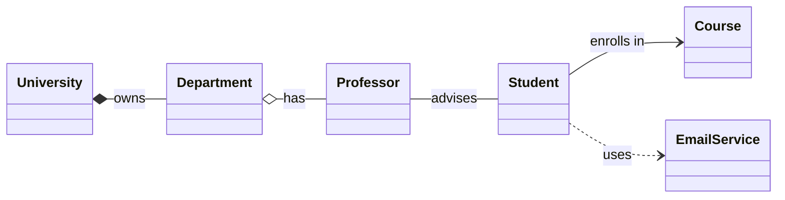

## The big idea

In real life, things are connected in different ways, and **how strongly** they are connected matters:

- A **taxi passenger** uses a taxi for one ride, then leaves. *(very loose)*
- A **teacher** knows their students, but both exist independently. *(loose)*
- A **football team** has players, but players can move to another team. *(medium)*
- A **house** has rooms. Demolish the house and the rooms are gone too. *(strong)*

OOP has a name for each of these. Knowing them helps you **design** classes and **read** UML diagrams in interviews and design docs.


## Quick overview

| Relationship | Meaning | Lifetime | Everyday example | UML symbol |
| --- | --- | --- | --- | --- |
| **Dependency** | *uses* briefly | Not stored at all | Passenger uses a taxi | dashed arrow `⇢` |
| **Association** | *knows about* | Independent | Teacher ↔ Student | solid line `—` |
| **Aggregation** | *has*, parts can live alone | Independent | Team ◇— Player | hollow diamond `◇` |
| **Composition** | *owns*, parts die with it | Owner controls it | House ◆— Room | filled diamond `◆` |

## 1. Dependency: "uses"

One object **uses** another temporarily, usually as a method parameter, and doesn't keep it.

```ts
class ReceiptPrinter {
  print(order: Order) {          // uses Order only during this call
    return `Order #${order.id}: $${order.total}`;
  }
}
```

`ReceiptPrinter` doesn't store the order. When `print()` ends, the link is gone.

## 2. Association: "knows about"

Two objects hold a **reference** to each other (or one to the other), but **neither owns** the other. Both are created and destroyed independently.

```ts
class Doctor {
  private patients: Patient[] = [];
  addPatient(p: Patient) { this.patients.push(p); }
}

class Patient {
  constructor(public name: string) {}
}

const ana = new Patient("Ana");
const drLee = new Doctor();
drLee.addPatient(ana);
// If Dr. Lee retires, Ana still exists and can see another doctor.
```

## 3. Aggregation: "has a" (parts can live alone)

A **whole** contains **parts**, but the parts are created **outside** and can exist without the whole.

```ts
class Player {
  constructor(public name: string) {}
}

class Team {
  private players: Player[] = [];
  constructor(public name: string) {}

  sign(player: Player) { this.players.push(player); }       // part comes from outside
  release(player: Player) {
    this.players = this.players.filter((p) => p !== player);
  }
}

const mia = new Player("Mia");
const tigers = new Team("Tigers");
tigers.sign(mia);
// Disband the team → Mia still exists and can join another team.
```

## 4. Composition: "owns" (parts die with the whole)

The whole **creates and owns** its parts. The parts make no sense on their own and are destroyed with the whole.

```ts
class Room {
  constructor(public name: string, public areaM2: number) {}
}

class House {
  private rooms: Room[];

  constructor() {
    // The house creates its own rooms; nobody else holds them
    this.rooms = [new Room("Kitchen", 12), new Room("Bedroom", 15)];
  }

  get totalArea() {
    return this.rooms.reduce((sum, r) => sum + r.areaM2, 0);
  }
}

const home = new House();
// When `home` is garbage-collected, its rooms go with it.
```

More real examples: an `Order` owns its `OrderLine`s, and a `Document` owns its `Paragraph`s.

> 💡 **Composition (the relationship)** and **"composition over inheritance"** (the design advice from the previous lesson) are related. Both mean "build from parts". The advice uses the word loosely, for any *has-a* relationship.

## How to tell aggregation from composition

Ask two questions:

1. **Who creates the part?** Created *inside* the whole → composition. Passed in from *outside* → aggregation.
2. **Can the part live without the whole?** No → composition. Yes → aggregation.

| | Aggregation | Composition |
| --- | --- | --- |
| Created by | Someone else, then passed in | The whole itself |
| Shared with others? | Can be | Never |
| Deleted with the whole? | ❌ No | ✅ Yes |
| Example | `Playlist` ◇— `Song` | `Order` ◆— `OrderLine` |

## Drawing it: a UML class diagram



Read it as:

- A **University owns** Departments. Close the university and its departments are gone (composition `*--`).
- A **Department has** Professors, who can move to another department (aggregation `o--`).
- A **Professor advises** Students, and both exist independently (association `--`).
- A **Student uses** an EmailService only while sending a message (dependency `..>`).

Also common in UML class diagrams:

| Symbol | Meaning |
| --- | --- |
| `Child --\|> Parent` (hollow triangle) | Inheritance ("is a") |
| `Class ..\|> Interface` (dashed, hollow triangle) | Implements an interface |
| `1`, `0..1`, `*`, `1..*` near a line | Multiplicity: how many objects on each side |

## Why it matters

- **Ownership decides deletion.** Deleting an `Order` should delete its `OrderLine`s (composition) but **never** the `Customer` (association).
- **Databases follow the same rules.** Composition is often `ON DELETE CASCADE`; association and aggregation are not.
- **Interviews.** "What's the difference between aggregation and composition?" is a classic OOP question.

## Common mistakes

- **Treating every "has" as composition.** If the part is shared or outlives the whole, it's aggregation or association.
- **Exposing composed parts.** If `House` returns its internal `rooms` array, callers can change the house's insides. Return copies or provide methods instead.
- **Over-thinking the diagram.** In day-to-day work, the most important question is simply *"who owns this, and who deletes it?"*

## Key takeaways

- **Dependency** (uses) → **Association** (knows) → **Aggregation** (has, shared) → **Composition** (owns): weakest to strongest.
- Composition means the whole **creates and destroys** its parts.
- Aggregation means parts come from outside and can live on their own.
- In UML: dashed arrow = dependency, line = association, ◇ = aggregation, ◆ = composition.

## Try it yourself

Classify each pair: `Car` and `Engine`, `Car` and `Driver`, `Library` and `Book`, `Invoice` and `InvoiceLine`, `Logger` passed into a method. Then draw them as a Mermaid `classDiagram`.
