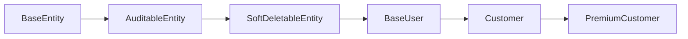

## The big idea

Knowing the four pillars is step one. Writing **good** object-oriented code means also knowing the traps. This lesson covers the mistakes that show up in real codebases, then the questions that come up again and again in interviews.


## Mistake 1: The god class

One class that knows and does everything: `AppManager`, `Utils`, `OrderService` with 3,000 lines.

```ts
// ❌ Does validation, pricing, payment, email, PDFs and logging
class OrderManager {
  validate() {}
  calculateTax() {}
  applyCoupon() {}
  chargeCard() {}
  sendConfirmationEmail() {}
  generateInvoicePdf() {}
  writeAuditLog() {}
  // …80 more methods
}
```

**Fix:** split by responsibility (**Single Responsibility Principle**). One class should have one reason to change.

```ts
// ✅ Small classes, each with one job
class OrderValidator { validate(order: Order) { /* … */ } }
class PriceCalculator { total(order: Order) { /* … */ } }
class PaymentService { charge(order: Order) { /* … */ } }
class OrderNotifier { confirm(order: Order) { /* … */ } }
```

## Mistake 2: The anemic model

Classes that hold only data, with all the logic living somewhere else. It looks like OOP, but it's procedural code in disguise.

```ts
// ❌ Data bag + logic outside
class Order {
  status = "draft";
  items: Item[] = [];
}

function submitOrder(order: Order) {
  if (order.items.length === 0) throw new Error("Empty order");
  order.status = "submitted"; // any code can set any status
}
```

```ts
// ✅ The object protects its own rules
class Order {
  #status: "draft" | "submitted" = "draft";
  #items: Item[] = [];

  addItem(item: Item) {
    if (this.#status !== "draft") throw new Error("Order is locked");
    this.#items.push(item);
  }

  submit() {
    if (this.#items.length === 0) throw new Error("Empty order");
    this.#status = "submitted";
  }

  get status() { return this.#status; }
}
```

> 💡 Plain data types (DTOs, API responses) are fine as data-only. The problem is **business objects** whose rules are scattered across the codebase.

## Mistake 3: Deep inheritance trees



Changing `BaseEntity` can break `PremiumCustomer` five levels down. **Fix:** keep hierarchies one or two levels deep and use composition for shared behavior.

## Mistake 4: Getters and setters for everything

```ts
// ❌ "Encapsulated" but every field is open
account.setBalance(account.getBalance() - amount);

// ✅ Expose behavior, not fields
account.withdraw(amount);
```

A setter with no rules is just a public field with extra typing.

## Mistake 5: Type checks instead of polymorphism

```ts
// ❌ Every new shape means editing this function (and others like it)
function area(shape: Shape) {
  if (shape instanceof Circle) return Math.PI * shape.r ** 2;
  if (shape instanceof Square) return shape.side ** 2;
}

// ✅ Each shape knows its own area
shapes.map((s) => s.area());
```

## More smells to watch for

| Smell | What it looks like | Fix |
| --- | --- | --- |
| **Feature envy** | A method uses another object's data more than its own | Move the method to that object |
| **Primitive obsession** | `email: string`, `price: number` everywhere, with validation copied around | Small value objects: `Email`, `Money` |
| **Refused bequest** | A subclass overrides parent methods to throw "not supported" | Wrong hierarchy: use composition or split the interface |
| **Static everything** | `UserUtils.create()`, `UserUtils.save()` | Real objects with injected dependencies |
| **`new` everywhere** | Classes create their own database, mailer and logger | Pass dependencies in through the constructor |

## Interview questions

<details>
<summary><strong>1. What is OOP, and what are its four pillars?</strong></summary>

OOP is a way of organizing code around **objects** that bundle **data** (state) with **behavior** (methods). The four pillars:

- **Encapsulation:** hide internal data and change it only through methods.
- **Abstraction:** expose what an object does, hide how.
- **Inheritance:** a class reuses and extends another class's code.
- **Polymorphism:** the same call behaves differently depending on the object.
</details>

<details>
<summary><strong>2. What is the difference between a class and an object?</strong></summary>

A **class** is a blueprint that defines properties and methods. An **object** is a concrete instance created from that class with `new`, with its own values. One `Dog` class can create many dog objects.
</details>

<details>
<summary><strong>3. Encapsulation vs abstraction?</strong></summary>

**Encapsulation** is about **protecting data**: making fields private and allowing changes only through methods that enforce rules. **Abstraction** is about **hiding complexity**: offering a simple interface (`send(email)`) while hiding the details (SMTP, retries). Encapsulation is a lock; abstraction is a simple dashboard.
</details>

<details>
<summary><strong>4. Interface vs abstract class?</strong></summary>

An **interface** is a contract only, with no code or state, and a class can implement many. An **abstract class** can contain shared code, fields and a constructor plus abstract methods for children to fill in, and a class can extend only one. Use an interface by default; use an abstract class when implementations share real logic.
</details>

<details>
<summary><strong>5. What is polymorphism? Give an example.</strong></summary>

Polymorphism means one interface, many implementations. For example, `PaymentMethod.pay(amount)` is implemented by `CardPayment`, `PayPalPayment` and `WalletPayment`. Checkout code calls `method.pay(total)` without knowing which one it has. **Runtime** polymorphism uses overriding; **compile-time** polymorphism uses overloading or generics.
</details>

<details>
<summary><strong>6. Method overloading vs overriding?</strong></summary>

- **Overloading:** same method name, **different parameters**, in the same class, chosen at compile time (Java/C#; TypeScript only has overload signatures with one implementation).
- **Overriding:** a subclass **replaces** a parent method with the same signature, chosen at runtime based on the actual object.
</details>

<details>
<summary><strong>7. Why "composition over inheritance"?</strong></summary>

Inheritance tightly couples a child to its parent's internals, can't be changed at runtime, and leads to class explosions when combining features. Composition builds objects from small parts behind interfaces, so parts can be swapped, combined freely and faked in tests. Use inheritance only for true, shallow "is-a" relationships.
</details>

<details>
<summary><strong>8. Aggregation vs composition?</strong></summary>

Both are "has-a". In **composition**, the whole creates and owns its parts, and they're destroyed together (`House` ◆— `Room`). In **aggregation**, the parts are created elsewhere and can exist on their own (`Team` ◇— `Player`).
</details>

<details>
<summary><strong>9. What is the Liskov Substitution Principle?</strong></summary>

A subclass must be usable anywhere its parent is expected, without breaking behavior. The classic violation is `Penguin extends Bird` where `fly()` throws. If a child can't honor the parent's promises, the hierarchy is wrong.
</details>

<details>
<summary><strong>10. What are SOLID principles?</strong></summary>

Five guidelines for maintainable OOP:

- **S**ingle Responsibility: one reason to change.
- **O**pen/Closed: open for extension, closed for modification.
- **L**iskov Substitution: subclasses must be substitutable.
- **I**nterface Segregation: many small interfaces beat one fat one.
- **D**ependency Inversion: depend on abstractions, not concrete classes.

(See the **Clean Code & SOLID** section for a full lesson on each.)
</details>

<details>
<summary><strong>11. Is JavaScript an object-oriented language?</strong></summary>

Yes, but it's **prototype-based**. The `class` keyword (ES2015) is mostly syntax on top of prototypes: methods live on `ClassName.prototype` and objects look them up through the prototype chain. JavaScript also supports functional programming, so most real code mixes both styles.
</details>

<details>
<summary><strong>12. What is a constructor? Can it be private?</strong></summary>

A constructor is the special method that runs when an object is created, to set its initial state. In TypeScript it can be `private`, which stops outside code from calling `new`. That's used in the **Singleton** pattern and for **static factory methods** like `Temperature.fromFahrenheit(212)`.
</details>

## Key takeaways

- Watch for **god classes, anemic models, deep hierarchies, getter/setter overload and type checks**.
- Good objects **own their rules** and expose **behavior**, not raw data.
- Prefer small classes, shallow hierarchies, composition and injected dependencies.
- In interviews, explain each concept with a **one-line definition + a real-life example + a short code example**.

## Where to go next

- **Clean Code & SOLID:** the five principles that turn OOP basics into maintainable designs.
- **Design Patterns:** proven OOP solutions such as Strategy, Observer, Factory and Decorator.
