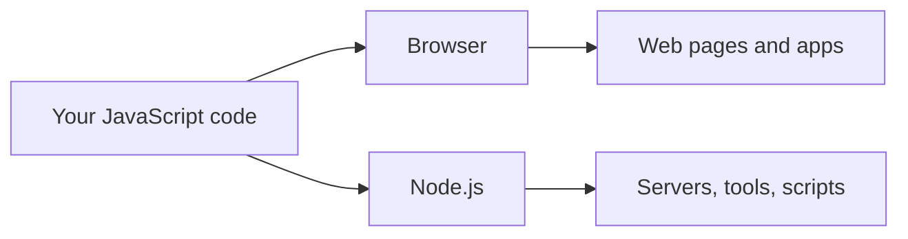

## What is JavaScript?

JavaScript (often shortened to **JS**) is a programming language. A programming language is a way to give a computer step-by-step instructions.

JavaScript is the language of the web. Every modern browser (Chrome, Firefox, Safari, Edge) can run it without installing anything.

```js
console.log("Hello, JavaScript!");
// → Hello, JavaScript!
```

> 📝 Note: JavaScript is **not** the same as Java. The names are similar, but they are two different languages.

## HTML, CSS and JavaScript

A web page is usually built with three languages. Each one has its own job.

| Language | Job | Think of it as |
|---|---|---|
| HTML | Structure: headings, text, buttons, images | The bones |
| CSS | Style: colors, fonts, spacing, layout | The clothes |
| JavaScript | Behavior: what happens when you click, type or scroll | The muscles |

Here is a tiny page that uses all three:

```html
<!DOCTYPE html>
<html>
<head>
  <style>
    h1 { color: teal; }
  </style>
</head>
<body>
  <h1 id="title">Hello!</h1>

  <script>
    document.getElementById("title").textContent = "Hello from JavaScript!";
  </script>
</body>
</html>
```

The HTML makes the heading, the CSS colors it teal, and the JavaScript changes its text.

## What can JavaScript do?

With JavaScript you can:

- Change text, images and styles on a page
- React when a user clicks, types or moves the mouse
- Check form inputs before they are sent
- Load new data from a server without reloading the page
- Build games, animations, and full web apps

## Where does JavaScript run?

JavaScript needs a **runtime**. A runtime is a program that reads your code and runs it.

- **The browser.** Every browser has a JavaScript engine built in. Chrome uses one called V8.
- **Node.js.** Node.js takes the V8 engine out of the browser so you can run JS on your computer or a server.



In this tutorial, most examples run in the browser. Many will also work in Node.js.

## Your first program

Create a file called `index.html`, paste this code, and open it in your browser.

```html
<!DOCTYPE html>
<html>
<body>
  <p id="message">Click the button.</p>
  <button onclick="sayHello()">Say hello</button>

  <script>
    function sayHello() {
      document.getElementById("message").textContent = "Hello, world!";
      console.log("The button was clicked");
    }
  </script>
</body>
</html>
```

When you click the button, the text changes to **Hello, world!**

Let's look at the new words:

- `<script>` is the HTML tag that holds JavaScript code.
- `function sayHello() { ... }` creates a **function**, a named block of code you can run later.
- `onclick="sayHello()"` tells the button to run `sayHello` when clicked.
- `document.getElementById("message")` finds the element with `id="message"`.
- `.textContent = ...` changes its text.
- `console.log(...)` prints a message to the browser console.

## Opening the browser console

The **console** is a hidden panel in your browser where `console.log` messages appear. It also shows errors.

How to open it:

1. Right-click anywhere on the page and choose **Inspect**.
2. Click the **Console** tab.
3. Or use the shortcut: `F12`, or `Ctrl + Shift + J` (Windows/Linux), or `Cmd + Option + J` (Mac).

You can also type JavaScript straight into the console and press Enter:

```js
2 + 3
// → 5

"Hi".toUpperCase()
// → "HI"
```

> 💡 Tip: Keep the console open while you learn. It is the fastest way to test a small idea.

## A short history

JavaScript was created in **1995** by Brendan Eich at Netscape. He wrote the first version in about 10 days.

The official standard for the language is called **ECMAScript** (ES). Browsers follow this standard so the same code works everywhere.

| Version | Year | Big additions |
|---|---|---|
| ES5 | 2009 | Strict mode, JSON support |
| ES6 / ES2015 | 2015 | `let`, `const`, arrow functions, classes, modules |
| ES2016 and later | Every year | Small yearly updates (`async/await`, `??`, `?.`, and more) |

> 📝 Note: When people say "modern JavaScript" or "ES6+", they mean ES2015 and newer. This tutorial teaches modern JavaScript.

## What you will learn in this tutorial

The lessons build on each other, one small step at a time:

1. Introduction (this lesson)
2. Where To & Output
3. Syntax, Statements & Comments
4. Variables
5. Operators
6. Data Types
7. Strings & Template Literals
8. Numbers & Math
9. Booleans, If/Else & Switch
10. Loops
11. Functions
12. Arrays
13. Array Methods
14. Objects
15. Dates
16. Scope, Hoisting & Closures
17. Classes & `this`
18. Modern JS (ES6+)
19. JSON
20. Errors & Debugging
21. HTML DOM
22. Events
23. Forms & Validation
24. Browser BOM: window, timers, localStorage
25. Async JS: callbacks, promises, async/await, fetch
26. Modules
27. Regular Expressions
28. Best Practices & Common Mistakes
29. Practice Projects

## Try it yourself

**Task 1:** Open the browser console and print your name with `console.log`.

<details>
<summary>Show solution</summary>

```js
console.log("Sam");
// → Sam
```
</details>

**Task 2:** In the console, work out how many minutes are in one day.

<details>
<summary>Show solution</summary>

```js
24 * 60
// → 1440
```
</details>

**Task 3:** Change the first program so the button shows **"Welcome to JavaScript!"** instead.

<details>
<summary>Show solution</summary>

```js
function sayHello() {
  document.getElementById("message").textContent = "Welcome to JavaScript!";
}
```
</details>

## Quick check

<details>
<summary>What are the three jobs of HTML, CSS and JavaScript?</summary>

HTML gives structure, CSS gives style, and JavaScript gives behavior.
</details>

<details>
<summary>Name two places where JavaScript can run.</summary>

In the browser, and on a computer or server with Node.js.
</details>

<details>
<summary>What is ECMAScript?</summary>

It is the official standard that defines the JavaScript language.
</details>

## Key takeaways

- JavaScript is the programming language of the web.
- HTML is structure, CSS is style, JavaScript is behavior.
- JS runs in every browser and on servers with Node.js.
- `console.log()` prints messages to the console, your best friend while learning.
- ECMAScript is the standard; "ES6+" means modern JavaScript.
