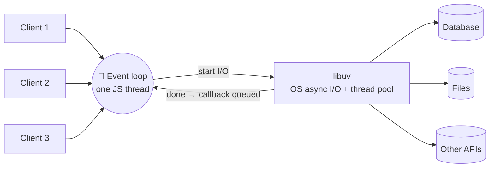
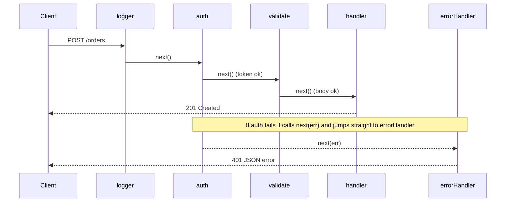

## The big idea

**Node.js** is the JavaScript engine from Chrome (V8) taken out of the browser, plus a library (libuv) that talks to the operating system for files, networks and timers. It lets JavaScript be a server.

**Express** is a thin layer on top: a way to say "when a `GET /users/:id` arrives, run these functions in order". Those functions are **middleware**, like stations on an **airport security line**: check the ticket, scan the bag, check the passport, and at any station you can be sent back.


## Node.js in one picture



| Feature | What it means for you |
| --- | --- |
| Non-blocking I/O | One process can hold thousands of idle connections cheaply |
| Single JS thread | CPU-heavy code blocks everyone (see the async lesson) |
| npm | The largest package registry; also the largest supply-chain risk |
| Same language as the frontend | Share types and validation between client and server |
| `cluster` / multiple processes | Use all CPU cores (or run several containers behind a load balancer) |

### Node vs Express

| Node.js alone | With Express |
| --- | --- |
| `http.createServer((req, res) => …)` | `app.get("/users/:id", handler)` |
| Parse URL, method and body yourself | Routing, params, `express.json()` built in |
| Write your own plumbing for errors | Error-handling middleware |

## A first server

```js
import express from "express";

const app = express();
app.use(express.json({ limit: "100kb" })); // parse JSON bodies, with a size cap

app.get("/health", (_req, res) => res.json({ ok: true }));

app.get("/users/:id", async (req, res) => {
  const user = await users.findById(req.params.id);
  if (!user) return res.status(404).json({ error: "User not found" });
  res.json(user);
});

app.listen(3000, () => console.log("Listening on http://localhost:3000"));
```

| Where data lives | Example | Read with |
| --- | --- | --- |
| Path parameter | `/users/42` | `req.params.id` |
| Query string | `/users?page=2` | `req.query.page` (always a **string**) |
| Body | JSON in a POST | `req.body` (after `express.json()`) |
| Header | `Authorization: Bearer …` | `req.get("authorization")` |

## Middleware: the pipeline ⭐

A middleware is `(req, res, next) => { … }`. It can **read/modify** the request, **end** the response, or call `next()` to pass it on.



```js
// Application-level: runs for every request
app.use((req, res, next) => {
  const start = performance.now();
  res.on("finish", () => {
    console.log(`${req.method} ${req.originalUrl} ${res.statusCode} ${Math.round(performance.now() - start)}ms`);
  });
  next();
});

// Route-level: only where you attach it
function requireAuth(req, _res, next) {
  const token = req.get("authorization")?.replace("Bearer ", "");
  if (!token) return next(new HttpError(401, "Missing token"));
  try {
    req.user = verifyJwt(token);
    next();
  } catch {
    next(new HttpError(401, "Invalid token"));
  }
}

app.post("/orders", requireAuth, validate(CreateOrder), createOrder);
```

> ⚠️ **Order matters.** Middleware runs in the order you `app.use()` it. Body parsing must come before routes that read `req.body`; the error handler must come **last**.

## Validation and errors

```js
import { z } from "zod";

class HttpError extends Error {
  constructor(status, message) { super(message); this.status = status; }
}

const validate = (schema) => (req, _res, next) => {
  const result = schema.safeParse(req.body);
  if (!result.success) return next(new HttpError(400, result.error.issues[0].message));
  req.body = result.data;
  next();
};

// The error handler has FOUR parameters — that's how Express recognises it
app.use((err, req, res, _next) => {
  const status = err.status ?? 500;
  if (status >= 500) req.log?.error({ err }, "request failed");
  res.status(status).json({
    error: status >= 500 ? "Internal server error" : err.message, // never leak internals
  });
});
```

**Express 5** (the current major version) forwards rejected promises from `async` handlers to the error handler automatically. In Express 4 you needed `try/catch` + `next(err)` or a wrapper in every async route.

## Structuring a larger app

Keep HTTP details at the edge and business rules in plain functions you can test without a server.

```text
src/
├── app.js              # builds the express app (no listen) — easy to test
├── server.js           # reads config, calls app.listen, handles shutdown
├── config.js           # validated environment variables
├── middleware/         # auth, validate, errorHandler, requestId
└── modules/
    └── orders/
        ├── orders.routes.js      # URL → controller
        ├── orders.controller.js  # HTTP in/out only
        ├── orders.service.js     # business rules
        └── orders.repository.js  # database queries
```

```js
// orders.routes.js
import { Router } from "express";
export const ordersRouter = Router();
ordersRouter.get("/", listOrders);
ordersRouter.post("/", requireAuth, validate(CreateOrder), createOrder);

// app.js
app.use("/api/orders", ordersRouter);
```

## Configuration

```js
// config.js — fail at startup, not at the first request
import { z } from "zod";

export const config = z.object({
  NODE_ENV: z.enum(["development", "test", "production"]).default("development"),
  PORT: z.coerce.number().default(3000),
  DATABASE_URL: z.string().url(),
  JWT_SECRET: z.string().min(32),
}).parse(process.env);
```

Load a local `.env` with `node --env-file=.env server.js` (built into Node 20.6+). Never commit `.env` files with real secrets.

## Production essentials

| Concern | Tool / approach |
| --- | --- |
| Security headers | `helmet()` |
| CORS | `cors({ origin: ["https://app.example.com"], credentials: true })`, never `*` with cookies |
| Rate limiting | `express-rate-limit` (with a Redis store when you run several instances) |
| Structured logs | `pino` / `pino-http` with a request ID on every line |
| File uploads | `multer` with size and type limits, store in object storage (S3) |
| Using all cores | Several processes: containers, PM2, or `node:cluster` |
| Unhandled errors | Log, exit and let the orchestrator restart the process |

```js
import helmet from "helmet";
import rateLimit from "express-rate-limit";

app.disable("x-powered-by");
app.use(helmet());
app.use("/api/auth", rateLimit({ windowMs: 15 * 60_000, limit: 20 }));
```

### Graceful shutdown

When Kubernetes or Docker stops your container it sends `SIGTERM`. Finish in-flight requests before exiting:

```js
const server = app.listen(config.PORT);

process.on("SIGTERM", () => {
  server.close(async () => {   // stop accepting, wait for open requests
    await db.end();
    process.exit(0);
  });
  setTimeout(() => process.exit(1), 10_000).unref(); // hard stop if stuck
});
```

### Preventing memory leaks

A Node process runs for days, so anything that stays **reachable** never gets garbage-collected. Leaks almost always come from a reference you forgot to drop.

| Cause | Fix |
| --- | --- |
| Global or module-level references (`const sessions = {}` that only grows) | Keep request data inside the request; avoid stashing it on globals |
| Event listeners added per request and never removed | `emitter.off(...)` / `once(...)`, or an `AbortSignal` to remove them |
| `setInterval` / `setTimeout` left running | `clearInterval` / `clearTimeout` when the work or connection ends |
| Unbounded in-memory caches (`Map` used as a cache) | Cap size and add TTLs (`lru-cache`), or move the cache to Redis |
| Database connections and streams never closed | Use a pool, release clients in `finally`, close everything on shutdown |

```js
// ❌ Leaks: a new listener and timer per connection, never cleaned up
io.on("connection", (socket) => {
  bus.on("price", (p) => socket.emit("price", p));
  setInterval(() => socket.emit("ping"), 30_000);
});

// ✅ Clean up when the connection closes
io.on("connection", (socket) => {
  const onPrice = (p) => socket.emit("price", p);
  bus.on("price", onPrice);
  const timer = setInterval(() => socket.emit("ping"), 30_000);

  socket.on("disconnect", () => {
    bus.off("price", onPrice);
    clearInterval(timer);
  });
});

// ✅ Bounded cache instead of a Map that grows forever
import { LRUCache } from "lru-cache";
const cache = new LRUCache({ max: 10_000, ttl: 5 * 60_000 });

// ✅ Always release pooled DB clients
const client = await pool.connect();
try {
  await client.query("SELECT 1");
} finally {
  client.release();
}
```

A warning like `MaxListenersExceededWarning` usually means you are adding listeners in a loop or per request.

### Heap snapshots and profiling

When memory or latency looks wrong, don't guess. Measure it with Node's built-in diagnostic tools. **Heap snapshots** answer *"what is holding memory?"* and **profiling** answers *"where is the time going?"*

#### Step 1: Monitor memory over time

Chart `process.memoryUsage().heapUsed` (or the container's RSS) in your metrics. The shape tells you whether you have a leak:


```js
setInterval(() => {
  const { heapUsed, rss } = process.memoryUsage();
  metrics.gauge("node.heap_used_mb", heapUsed / 1024 / 1024);
  metrics.gauge("node.rss_mb", rss / 1024 / 1024);
}, 15_000).unref(); // unref: don't keep the process alive just for this
```

#### Step 2: Take heap snapshots

A **heap snapshot** is a picture of every object in the V8 heap at one moment: what it is, how much memory it uses, and **which references keep it alive** (its *retainers*). It shows you:

- Which objects use the most memory.
- Which objects keep growing in number.
- Which objects are being kept unnecessarily.
- Which reference chain is stopping the garbage collector from freeing them.

**Example:** your API starts at 100 MB. After 10,000 requests it is at 500 MB and never comes back down. Take one snapshot before the load and one after, then compare them:


**How to take one locally:**

```bash
node --inspect server.js
```

1. Open Chrome and go to `chrome://inspect`.
2. Under **Remote Target**, click **inspect** on your Node process.
3. Open the **Memory** tab, choose **Heap snapshot**, and click **Take snapshot** (this is your baseline).
4. Apply load, for example `npx autocannon -c 50 -d 30 http://localhost:3000/api/orders`.
5. Click the 🗑️ **Collect garbage** icon, then take a second snapshot.
6. Select snapshot 2, switch the view from **Summary** to **Comparison**, and sort by **Size Delta**.
7. Click the suspicious constructor (here `Session`) and read the **Retainers** panel. It shows the chain from a GC root to the object, so you can see which reference to remove.

**In production or a container** (no DevTools attached):

```bash
node --heapsnapshot-signal=SIGUSR2 server.js
kill -USR2 <pid>          # writes Heap.<date>.<pid>.heapsnapshot to the working directory
```

Or from code: `require("node:v8").writeHeapSnapshot()`. Load the `.heapsnapshot` file in the DevTools Memory tab to analyse it.

> ⚠️ Taking a snapshot **pauses the process** and needs roughly as much extra memory as the heap itself. Take it on one instance pulled out of the load balancer, never on the whole fleet at once. Snapshots also contain real data (tokens, personal data), so handle the files as sensitive.

#### Step 3: Profile CPU and performance

**Profiling** records what your application does *while it runs*. It helps you find:

- High CPU usage.
- High memory allocation.
- Slow functions.
- Expensive operations.
- Bottlenecks that block the event loop.

Suppose `GET /report` takes 5 seconds. A CPU profile tells you whether the cause is an inefficient loop, a CPU-heavy calculation, synchronous blocking calls (`fs.readFileSync`, `bcrypt.hashSync`), or expensive JSON processing:


```bash
# Option A: V8 tick profiler (text report)
node --prof server.js                       # writes isolate-0x...-v8.log
node --prof-process isolate-*.log > profile.txt

# Option B: .cpuprofile file you open in Chrome DevTools → Performance (flame chart)
node --cpu-prof server.js

# Option C: the same, live, through chrome://inspect → Performance → Record
node --inspect server.js
```

For memory, `node --heap-prof` records **where allocations come from** (which function created the objects). Tools such as `clinic doctor`, `clinic flame` and `clinic heapprofiler` wrap all of this in one command.

#### Heap snapshot vs profiling

| | Heap snapshot | Profiling |
| --- | --- | --- |
| Question it answers | What is holding memory? | Where is time or work spent? |
| Captures | One moment in time | A period while the app runs |
| Shows | Retained objects and their reference chains | Hot functions, call stacks, CPU time |
| Finds | Memory leaks | Slow functions and event-loop blocking |
| Tools | DevTools Memory, `--heapsnapshot-signal`, `v8.writeHeapSnapshot()` | `--prof`, `--cpu-prof`, `--heap-prof`, DevTools Performance, `clinic` |

#### Interview question

**Q: How do you identify and fix memory leaks in Node.js?**

> "First I monitor memory over time. A sawtooth whose floor keeps rising after each GC is the signal. Then I reproduce it in staging, take a heap snapshot before and after applying load, and use the Comparison view to find objects that are created but never deleted. The Retainers panel shows the reference chain keeping them alive, usually an unbounded cache, a global map, an event listener that was never removed, or a timer that was never cleared. I fix the code that holds the reference, not just raise `--max-old-space-size`. Finally I run the same load test again and confirm memory goes flat."

#### Check yourself

Your app uses 150 MB at startup. After 50,000 requests it uses 900 MB and never drops, even after GC. Which tool would you mainly use to find which objects are being kept in memory?

- A) Heap snapshot
- B) Postman
- C) Nodemon
- D) Express middleware

<details>
<summary>Show answer</summary>

**A) Heap snapshot.** Take one before and one after the load, then compare them to see which objects grew and what keeps them alive. Postman sends requests, Nodemon restarts the app on file changes, and middleware handles requests. None of them inspect the heap.
</details>

## Testing a route

```js
import request from "supertest";
import { buildApp } from "../src/app.js";

test("GET /health returns ok", async () => {
  const res = await request(buildApp()).get("/health");
  expect(res.status).toBe(200);
  expect(res.body).toEqual({ ok: true });
});
```

## Key takeaways

- Node.js = V8 + libuv: one JavaScript thread, non-blocking I/O, great for I/O-heavy APIs.
- Express is routing + a **middleware pipeline**; order matters and the 4-argument error handler goes last.
- Validate every request at the edge, return consistent JSON errors, and never leak stack traces.
- Split routes → controller → service → repository; export the app separately from `listen`.
- Validate config at startup, add `helmet`, CORS, rate limits and structured logs, and shut down gracefully on `SIGTERM`.
- Prevent memory leaks by dropping references: remove listeners, clear timers, bound caches, close connections, and monitor heap usage over time.
- Use **heap snapshots** (compare before and after load, then read the retainers) to find leaks, and **CPU profiles** (flame charts) to find slow or blocking code.
