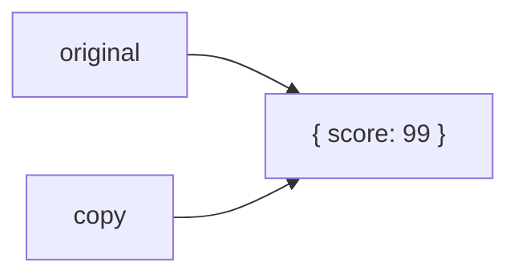

## What is a data type?

A **data type** is the kind of value something is. A number, a piece of text and a yes/no answer are different kinds of data.

```js
let age = 30;           // number
let name = "Ana";       // string (text)
let isStudent = false;  // boolean (true/false)
```

The type decides what you can do with a value. You can multiply numbers, but not yes/no answers.

## The 8 data types

JavaScript has **8** data types. Seven are **primitives** (simple, single values) and one is **object**.

| Type | What it holds | Example |
|---|---|---|
| `string` | Text | `"Hello"`, `'JS'` |
| `number` | Whole and decimal numbers | `42`, `3.14`, `-7` |
| `bigint` | Very large whole numbers | `9007199254740993n` |
| `boolean` | Yes / no | `true`, `false` |
| `undefined` | "No value given yet" | `undefined` |
| `null` | "Empty on purpose" | `null` |
| `symbol` | A unique ID | `Symbol("id")` |
| `object` | A collection of values | `{ name: "Ana" }`, `[1, 2, 3]` |

> 📝 Note: Arrays, functions and dates are all kinds of **object**. As a beginner you will mostly use string, number, boolean, undefined, null and object.

## The `typeof` operator

`typeof` returns the type of a value as a string.

| Code | Result |
|---|---|
| `typeof "Hi"` | `"string"` |
| `typeof 42` | `"number"` |
| `typeof 10n` | `"bigint"` |
| `typeof true` | `"boolean"` |
| `typeof undefined` | `"undefined"` |
| `typeof Symbol()` | `"symbol"` |
| `typeof { a: 1 }` | `"object"` |
| `typeof [1, 2]` | `"object"` |
| `typeof null` | `"object"` ⚠️ |
| `typeof function () {}` | `"function"` |

> ⚠️ Watch out: `typeof null` gives `"object"`. This is an old bug in JavaScript that can never be fixed. To check for null, use `value === null`.

To check if something is an array, use `Array.isArray()`:

```js
console.log(Array.isArray([1, 2])); // → true
console.log(Array.isArray("hi"));   // → false
```

## Dynamic typing

JavaScript is **dynamically typed**. That means a variable has no fixed type; it can hold any type, and the type can change.

```js
let box = 5;
console.log(typeof box); // → number

box = "five";
console.log(typeof box); // → string
```

> 💡 Tip: Just because you *can* change a variable's type doesn't mean you should. Keeping one type per variable makes code easier to follow.

## `undefined` vs `null`

Both mean "no value", but they are used differently.

- `undefined`: JavaScript's way of saying "nothing has been assigned yet".
- `null`: **you** set it to say "this is empty on purpose".

```js
let phone;
console.log(phone); // → undefined (never given a value)

let selectedItem = null; // nothing selected, on purpose
console.log(selectedItem); // → null
```

```js
console.log(null === undefined); // → false (different types)
console.log(null == undefined);  // → true  (loose equality treats them alike)
```

## Primitives vs objects

This difference matters when you copy values.

### Primitives are copied by value

When you copy a primitive, you get a **separate copy**. Changing one does not change the other.

```js
let a = 10;
let b = a;   // b gets its own copy of 10
b = 20;

console.log(a); // → 10
console.log(b); // → 20
```

### Objects are copied by reference

An object variable holds a **reference**, like an address pointing to where the object lives. Copying it copies the address, not the object. Both variables now point to the **same** object.

```js
const original = { score: 10 };
const copy = original;  // same object, two names
copy.score = 99;

console.log(original.score); // → 99 😮
```



To make a real, separate copy of a simple object, use the spread syntax `{ ...obj }`:

```js
const first = { score: 10 };
const second = { ...first };
second.score = 99;

console.log(first.score);  // → 10
console.log(second.score); // → 99
```

> 📝 Note: You will learn more about spread in the Modern JS lesson.

## Type conversion (on purpose)

Sometimes you need to change a value from one type to another. This is called **type conversion**.

| Function | Converts to | Example | Result |
|---|---|---|---|
| `String(x)` | string | `String(123)` | `"123"` |
| `Number(x)` | number | `Number("42")` | `42` |
| `Number(x)` | number | `Number("42px")` | `NaN` |
| `parseInt(x)` | whole number | `parseInt("42px")` | `42` |
| `parseFloat(x)` | decimal number | `parseFloat("3.5kg")` | `3.5` |
| `Boolean(x)` | boolean | `Boolean("hi")` | `true` |

`NaN` means **"Not a Number"**. It is what you get when a conversion to a number fails.

```js
console.log(Number("hello")); // → NaN
console.log(Number(""));      // → 0
console.log(Number(true));    // → 1
console.log(parseInt("3.99")); // → 3
```

### Truthy and falsy

`Boolean()` turns any value into `true` or `false`. Only these values become `false`; they are called **falsy**:

```js
false, 0, -0, 0n, "", null, undefined, NaN
```

Everything else is **truthy**, even these:

```js
console.log(Boolean("0"));   // → true  (non-empty string)
console.log(Boolean("false")); // → true
console.log(Boolean([]));    // → true  (empty array)
console.log(Boolean({}));    // → true  (empty object)
```

## Automatic conversion (coercion) surprises

When you mix types, JavaScript sometimes converts them for you. This is called **coercion**, and it can surprise you.

```js
console.log("5" + 2);    // → "52"   (+ joins strings)
console.log("5" - 2);    // → 3      (- forces numbers)
console.log("5" * "2");  // → 10
console.log(true + 1);   // → 2      (true becomes 1)
console.log([] + []);    // → ""     (empty string)
console.log("10" / "abc"); // → NaN
```

> 💡 Tip: Avoid relying on coercion. Convert values yourself with `Number()` or `String()`, and compare with `===`.

## Try it yourself

**Task 1:** Print the type of each value: `"42"`, `42`, `null`, `[]`.

<details>
<summary>Show solution</summary>

```js
console.log(typeof "42"); // → string
console.log(typeof 42);   // → number
console.log(typeof null); // → object (old bug!)
console.log(typeof []);   // → object
```
</details>

**Task 2:** Turn `"19.99"` into a number and add `5` to it.

<details>
<summary>Show solution</summary>

```js
const price = Number("19.99");
console.log(price + 5); // → 24.99
```
</details>

**Task 3:** Copy this object so changing the copy does **not** change the original.

```js
const settings = { dark: false };
```

<details>
<summary>Show solution</summary>

```js
const settings = { dark: false };
const mySettings = { ...settings };
mySettings.dark = true;

console.log(settings.dark);   // → false
console.log(mySettings.dark); // → true
```
</details>

## Quick check

<details>
<summary>What does <code>typeof null</code> return, and why is it strange?</summary>

`"object"`. It is a famous bug from the first version of JavaScript, kept so old websites don't break.
</details>

<details>
<summary>Is the string <code>"0"</code> truthy or falsy?</summary>

Truthy. Only the empty string `""` is falsy.
</details>

<details>
<summary>What is the result of <code>Number("12abc")</code> and <code>parseInt("12abc")</code>?</summary>

`Number("12abc")` is `NaN`. `parseInt("12abc")` is `12`, because it reads digits until it hits a non-digit.
</details>

## Key takeaways

- JavaScript has 8 types: 7 primitives (string, number, bigint, boolean, undefined, null, symbol) and object.
- `typeof` shows a value's type, but `typeof null` is `"object"`.
- `undefined` means "not assigned yet"; `null` means "empty on purpose".
- Primitives are copied by value; objects are shared by reference.
- Convert types yourself with `String()`, `Number()`, `parseInt()` and `Boolean()`.
- Falsy values: `false`, `0`, `""`, `null`, `undefined`, `NaN` (plus `-0` and `0n`).
