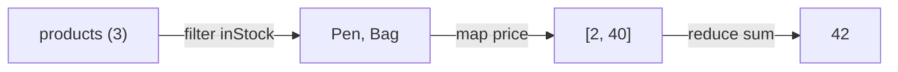

## Methods that take a function

The methods in this lesson all take a **callback**: a function that the method calls once for every item. The callback usually gets three arguments: `(item, index, array)`. Most of the time you only need `item`.

We'll use this array in many examples:

```js
const products = [
  { name: "Pen", price: 2, inStock: true },
  { name: "Book", price: 15, inStock: false },
  { name: "Bag", price: 40, inStock: true },
];
```

## forEach: do something with each item

`forEach` runs the callback for each item. It returns nothing (`undefined`).

```js
const nums = [1, 2, 3];

nums.forEach((n, i) => {
  console.log(`Index ${i}: ${n}`);
});
// → Index 0: 1
// → Index 1: 2
// → Index 2: 3
```

> 📝 Note: You can't `break` out of `forEach`. Use a `for...of` loop if you need to stop early.

## map: transform every item

`map` returns a **new** array of the same length, with each item replaced by what the callback returns.

```js
const nums = [1, 2, 3];
const doubled = nums.map((n) => n * 2);
console.log(doubled); // → [2, 4, 6]

const names = products.map((p) => p.name);
console.log(names);   // → ["Pen", "Book", "Bag"]
```

> ⚠️ Watch out: always `return` a value from a `map` callback. With `{}` braces and no `return`, you get an array full of `undefined`.

## filter: keep some items

`filter` returns a new array with only the items where the callback returns `true` (or truthy).

```js
const nums = [5, 12, 8, 130, 44];
const big = nums.filter((n) => n > 10);
console.log(big); // → [12, 130, 44]

const available = products.filter((p) => p.inStock);
console.log(available.length); // → 2
```

## find, findIndex, findLast

These search for the **first** match and stop as soon as they find it.

| Method | Returns | If nothing matches |
| --- | --- | --- |
| `find(fn)` | the first matching item | `undefined` |
| `findIndex(fn)` | the index of the first match | `-1` |
| `findLast(fn)` | the last matching item | `undefined` |
| `findLastIndex(fn)` | the index of the last match | `-1` |

```js
const nums = [3, 10, 18, 7, 25];

console.log(nums.find((n) => n > 9));       // → 10
console.log(nums.findIndex((n) => n > 9));  // → 1
console.log(nums.findLast((n) => n > 9));   // → 25
console.log(nums.find((n) => n > 100));     // → undefined

const book = products.find((p) => p.name === "Book");
console.log(book.price); // → 15
```

> 💡 Tip: Use `find` when you want **one** item. Use `filter` when you want **all** matching items.

## some and every

These answer yes/no questions about the array.

```js
const ages = [16, 21, 34];

console.log(ages.some((a) => a < 18));   // → true  (at least one is under 18)
console.log(ages.every((a) => a >= 18)); // → false (not all are 18+)
console.log(ages.every((a) => a > 10));  // → true
```

## reduce: boil an array down to one value

`reduce` walks through the array and keeps a running result called the **accumulator**. It's great for totals.

```js
const nums = [5, 10, 15];

const total = nums.reduce((acc, n) => acc + n, 0);
console.log(total); // → 30
```

The `0` at the end is the **starting value** of `acc`. Here is what happens step by step:

| Step | `acc` (before) | `n` | Returned `acc + n` |
| --- | --- | --- | --- |
| 1 | 0 | 5 | 5 |
| 2 | 5 | 10 | 15 |
| 3 | 15 | 15 | 30 |

The last returned value, `30`, is the result.

```js
const cartTotal = products.reduce((sum, p) => sum + p.price, 0);
console.log(cartTotal); // → 57
```

> ⚠️ Watch out: always give `reduce` a starting value. Without one, an empty array throws an error.

## sort and toSorted

`sort` changes the original array. `toSorted` returns a sorted **copy** and leaves the original alone.

```js
const prices = [40, 2, 15];

const cheapFirst = prices.toSorted((a, b) => a - b);
console.log(cheapFirst); // → [2, 15, 40]
console.log(prices);     // → [40, 2, 15] (unchanged)

const byName = products.toSorted((a, b) => a.name.localeCompare(b.name));
console.log(byName.map((p) => p.name)); // → ["Bag", "Book", "Pen"]
```

> 📝 Note: `localeCompare` compares two strings in alphabetical order. It's the easy way to sort text.

## flat and flatMap

`flat()` removes one level of nesting. `flatMap()` is `map` followed by `flat`.

```js
const nested = [1, [2, 3], [4, [5]]];
console.log(nested.flat());          // → [1, 2, 3, 4, [5]]
console.log(nested.flat(Infinity));  // → [1, 2, 3, 4, 5]

const sentences = ["hi there", "good day"];
const words = sentences.flatMap((s) => s.split(" "));
console.log(words); // → ["hi", "there", "good", "day"]
```

## Chaining methods

Methods that return arrays can be **chained**: you call the next method on the result of the last one.

```js
const total = products
  .filter((p) => p.inStock)   // Pen, Bag
  .map((p) => p.price)        // [2, 40]
  .reduce((sum, price) => sum + price, 0);

console.log(total); // → 42
```

Read it top to bottom like a recipe: keep the items in stock, take their prices, add them up.



## Mutating vs non-mutating

Some methods **mutate** (change) the original array. Others return a new array. Knowing which is which avoids lots of bugs.

| Changes the original ❗ | Safe copy version ✅ |
| --- | --- |
| `sort()` | `toSorted()` |
| `reverse()` | `toReversed()` |
| `splice()` | `toSpliced()` |
| `arr[i] = x` | `arr.with(i, x)` |
| `push()`, `pop()`, `shift()`, `unshift()` | `[...arr, x]`, `slice()` |

These never change the original: `map`, `filter`, `find`, `some`, `every`, `reduce`, `slice`, `concat`, `flat`, `flatMap`.

```js
const letters = ["a", "b", "c"];

console.log(letters.toReversed()); // → ["c", "b", "a"]
console.log(letters.with(1, "X")); // → ["a", "X", "c"]
console.log(letters);              // → ["a", "b", "c"] (unchanged)
```

> 💡 Tip: In frameworks like React, prefer the non-mutating versions. They make it easy to see what changed.

## Try it in a page

```html
<ul id="list"></ul>

<script>
  const scores = [45, 82, 67, 91, 30];
  const passed = scores.filter((s) => s >= 50).toSorted((a, b) => b - a);

  document.getElementById("list").innerHTML =
    passed.map((s) => `<li>${s}</li>`).join("");
</script>
```

## Try it yourself

**1.** Turn `["anna", "ben"]` into `["ANNA", "BEN"]`.

<details>
<summary>Show solution</summary>

```js
const upper = ["anna", "ben"].map((name) => name.toUpperCase());
console.log(upper); // → ["ANNA", "BEN"]
```
</details>

**2.** From `[1, 2, 3, 4, 5, 6]`, keep the even numbers and square them.

<details>
<summary>Show solution</summary>

```js
const result = [1, 2, 3, 4, 5, 6]
  .filter((n) => n % 2 === 0)
  .map((n) => n * n);

console.log(result); // → [4, 16, 36]
```
</details>

**3.** Use `reduce` to find the largest number in `[7, 42, 13]`.

<details>
<summary>Show solution</summary>

```js
const nums = [7, 42, 13];
const max = nums.reduce((best, n) => (n > best ? n : best), nums[0]);
console.log(max); // → 42
```
</details>

## Quick check

<details>
<summary>What is the difference between <code>map</code> and <code>forEach</code>?</summary>

`map` returns a new array built from the callback's return values. `forEach` returns `undefined`; it's only for doing something with each item.
</details>

<details>
<summary>What does <code>find</code> return if nothing matches?</summary>

`undefined`. (`findIndex` returns `-1`.)
</details>

<details>
<summary>How do you sort an array without changing the original?</summary>

Use `toSorted()`, or copy first with `[...arr].sort()`.
</details>

## Key takeaways

- Callback methods call your function once per item with `(item, index, array)`.
- `map` transforms, `filter` keeps, `find` gets one, `some`/`every` answer yes/no.
- `reduce` combines everything into one value; always pass a starting value.
- Chain `filter → map → reduce` to build clear data pipelines.
- `sort`, `reverse` and `splice` mutate; `toSorted`, `toReversed`, `toSpliced` and `with` return copies.
