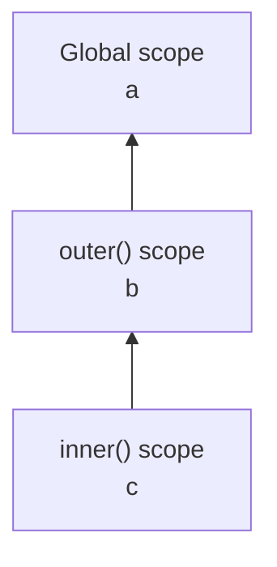

## What is scope?

**Scope** is the area of your code where a variable can be seen and used. Outside its scope, the variable does not exist.

JavaScript has three main kinds of scope: **global**, **function** and **block**.

## Global scope

A variable declared outside any function or block is **global**. Every part of your code can use it.

```js
const siteName = "CodeLab";

function showName() {
  console.log(siteName); // can see the global variable
}

showName(); // → "CodeLab"
```

> ⚠️ Watch out: Too many global variables cause name clashes between different parts of a program. Keep globals to a minimum.

## Function scope

A variable declared inside a function only lives inside that function.

```js
function greet() {
  const message = "Hello!";
  console.log(message);
}

greet();              // → "Hello!"
console.log(message); // ReferenceError: message is not defined
```

## Block scope

A **block** is any code between `{ }`, like an `if` or a `for` loop. Variables made with `let` and `const` only live inside their block.

```js
if (true) {
  const inside = "only here";
  let alsoInside = 42;
}
console.log(inside); // ReferenceError: inside is not defined
```

`var` ignores blocks. It only respects function scope.

```js
if (true) {
  var leaky = "I escaped!";
}
console.log(leaky); // → "I escaped!"
```

> 💡 Tip: This is one big reason to use `let` and `const` and avoid `var`.

## The scope chain

When you use a variable, JavaScript first looks in the current scope. If it is not there, it looks in the outer scope, then the next outer one, all the way to the global scope. This path is called the **scope chain**.



```js
const a = 1;

function outer() {
  const b = 2;
  function inner() {
    const c = 3;
    console.log(a + b + c); // looks up: c (here), b (outer), a (global)
  }
  inner();
}

outer(); // → 6
```

The search only goes **outward**, never inward. `outer` cannot see `c`.

## Shadowing

If an inner scope declares a variable with the same name as an outer one, the inner one **shadows** (hides) the outer one.

```js
const color = "blue";

function paint() {
  const color = "red"; // shadows the global color
  console.log(color);
}

paint();             // → "red"
console.log(color);  // → "blue"
```

> 📝 Note: Shadowing is legal, but it can confuse readers. Prefer different names when you can.

## Hoisting

**Hoisting** means JavaScript sets up your declarations before running the code, as if they were "lifted" to the top of their scope. But each kind of declaration behaves differently.

### var: hoisted as `undefined`

```js
console.log(score); // → undefined (no error!)
var score = 10;
console.log(score); // → 10
```

### let and const: the Temporal Dead Zone

`let` and `const` are hoisted too, but you cannot touch them before their line. The area before the declaration is called the **Temporal Dead Zone (TDZ)**.

```js
console.log(level); // ReferenceError: Cannot access 'level' before initialization
let level = 1;
```

This error is a good thing: it catches mistakes early.

### Function declarations: fully hoisted

A **function declaration** can be called before it appears in the code.

```js
sayHi(); // → "Hi!"

function sayHi() {
  console.log("Hi!");
}
```

But a function stored in a variable follows the variable's rules.

```js
sayBye(); // ReferenceError: Cannot access 'sayBye' before initialization
const sayBye = () => console.log("Bye!");
```

| Declaration | Hoisted? | Value before its line |
| --- | --- | --- |
| `var x` | Yes | `undefined` |
| `let x` / `const x` | Yes, but in the TDZ | ReferenceError |
| `function f() {}` | Yes, fully | The whole function |
| `const f = () => {}` | Like `const` | ReferenceError |

## Closures

A **closure** is a function that remembers the variables from the place where it was created, even after that outer function has finished.

```js
function makeCounter() {
  let count = 0;
  return function () {
    count++;
    return count;
  };
}

const counter = makeCounter();
console.log(counter()); // → 1
console.log(counter()); // → 2
console.log(counter()); // → 3
```

`makeCounter` finished running long ago, but the inner function still "carries" `count` with it. Each call to `makeCounter()` makes a **new, separate** `count`.

```js
const a = makeCounter();
const b = makeCounter();
a(); a();
console.log(a()); // → 3
console.log(b()); // → 1
```

## Practical uses of closures

### Private state

Nobody outside can change `balance` directly. They must use the functions you give them.

```js
function createWallet(start) {
  let balance = start;
  return {
    deposit: (amount) => { balance += amount; },
    getBalance: () => balance,
  };
}

const wallet = createWallet(50);
wallet.deposit(25);
console.log(wallet.getBalance()); // → 75
console.log(wallet.balance);      // → undefined (it's private)
```

### Function factories

A **function factory** is a function that builds and returns other functions.

```js
const multiplyBy = (factor) => (n) => n * factor;

const double = multiplyBy(2);
const triple = multiplyBy(3);
console.log(double(5)); // → 10
console.log(triple(5)); // → 15
```

## The classic var-in-loop bug

This code is meant to print 0, 1, 2 after a short delay.

```js
for (var i = 0; i < 3; i++) {
  setTimeout(() => console.log(i), 100);
}
// → 3
// → 3
// → 3
```

With `var` there is only **one** `i` for the whole loop. By the time the timers run, the loop is done and `i` is `3`.

The fix is simply `let`. It creates a **new** `i` for each loop round, and each closure remembers its own.

```js
for (let i = 0; i < 3; i++) {
  setTimeout(() => console.log(i), 100);
}
// → 0
// → 1
// → 2
```

## Try it yourself

**1.** What does this print? Think first, then check.

```js
let x = "outer";
function test() {
  let x = "inner";
  return x;
}
console.log(test(), x);
```

<details>
<summary>Show solution</summary>

```js
// → "inner" "outer"
// The x inside test() shadows the outer x, but does not change it.
```
</details>

**2.** Write `makeGreeter(greeting)` that returns a function taking a `name`, so `makeGreeter("Hello")("Sam")` returns `"Hello, Sam!"`.

<details>
<summary>Show solution</summary>

```js
const makeGreeter = (greeting) => (name) => `${greeting}, ${name}!`;

const hello = makeGreeter("Hello");
console.log(hello("Sam")); // → "Hello, Sam!"
```
</details>

**3.** Extend the counter: `makeCounter()` should return an object with `increment()`, `decrement()` and `value()`.

<details>
<summary>Show solution</summary>

```js
function makeCounter() {
  let count = 0;
  return {
    increment: () => ++count,
    decrement: () => --count,
    value: () => count,
  };
}

const c = makeCounter();
c.increment();
c.increment();
c.decrement();
console.log(c.value()); // → 1
```
</details>

## Quick check

<details>
<summary>What does <code>console.log(a); var a = 5;</code> print?</summary>

`undefined`. The `var` declaration is hoisted, but the value `5` is only set on its own line.
</details>

<details>
<summary>What is the Temporal Dead Zone?</summary>

The part of a scope before a `let` or `const` line. Using the variable there throws a `ReferenceError`.
</details>

<details>
<summary>In one sentence, what is a closure?</summary>

A function that remembers the variables from the scope where it was created, even after that scope has finished running.
</details>

## Key takeaways

- Scope decides where a variable can be used: global, function or block.
- `let` and `const` are block-scoped; `var` is only function-scoped, so avoid it.
- JavaScript looks for variables outward along the scope chain, never inward.
- `var` is hoisted as `undefined`, `let`/`const` sit in the TDZ, function declarations are fully hoisted.
- Closures let functions remember variables: great for private state and function factories.
- Use `let` in loops to avoid the classic "all 3s" bug.
