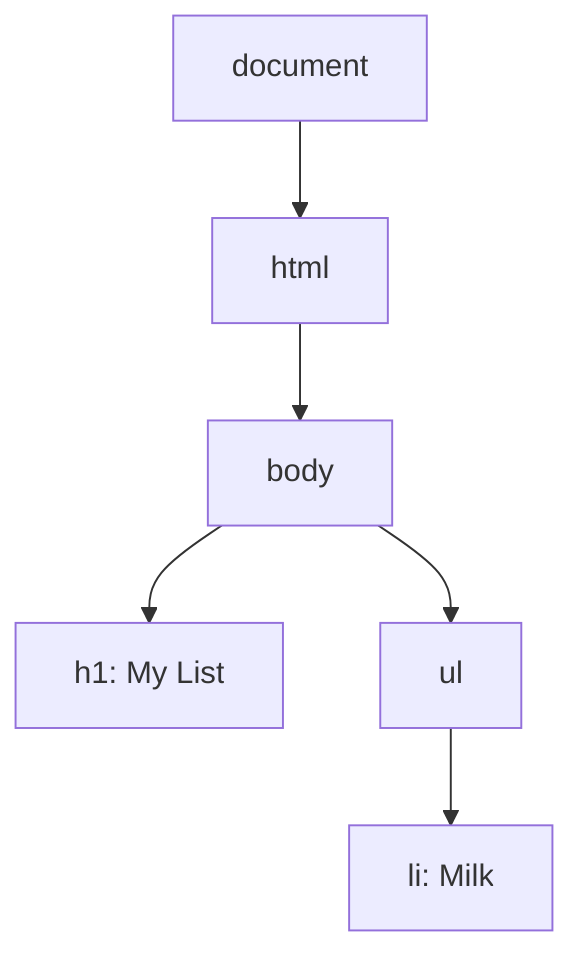

## What is the DOM?

When a browser loads a web page, it turns the HTML into a tree of objects. This tree is called the **DOM** (**Document Object Model**).

JavaScript can read and change this tree. When the tree changes, the page on screen changes too.

```html
<html>
  <body>
    <h1>My List</h1>
    <ul>
      <li>Milk</li>
    </ul>
  </body>
</html>
```

The browser sees this as a tree. Each box is called a **node**; element nodes are called **elements**.



## The document object

The **`document`** object is your entry point to the whole page.

```js
console.log(document.title);  // the page's <title> text
console.log(document.body);   // the <body> element
```

## Selecting elements

Before you change an element, you need to find it.

| Method | What it returns | Example |
| --- | --- | --- |
| `getElementById(id)` | One element with that id | `document.getElementById("title")` |
| `querySelector(css)` | The **first** match for a CSS selector | `document.querySelector(".card")` |
| `querySelectorAll(css)` | **All** matches, as a NodeList | `document.querySelectorAll("li")` |

```html
<h1 id="title">Hello</h1>
<p class="note">First note</p>
<p class="note">Second note</p>

<script>
  const title = document.getElementById("title");
  const firstNote = document.querySelector(".note");
  const allNotes = document.querySelectorAll(".note");

  console.log(title.textContent);     // → "Hello"
  console.log(firstNote.textContent); // → "First note"
  console.log(allNotes.length);       // → 2
</script>
```

> 💡 Tip: `querySelector` and `querySelectorAll` accept any CSS selector, like `"#menu a"` or `"input[type=email]"`. Most developers use them for everything.

### Looping over a NodeList

A **NodeList** is a list of nodes. It is not an array, but it has `forEach`.

```js
document.querySelectorAll(".note").forEach((note, i) => {
  note.textContent = `Note number ${i + 1}`;
});
```

> 📝 Note: If an element is not found, `querySelector` returns `null`. Using `null.textContent` causes a TypeError, so check your selectors.

## Changing content

### textContent

**`textContent`** reads or sets the plain text inside an element.

```js
const title = document.getElementById("title");
title.textContent = "Welcome!";
```

### innerHTML

**`innerHTML`** reads or sets the HTML inside an element. Tags are turned into real elements.

```js
const box = document.querySelector(".note");
box.innerHTML = "<strong>Bold</strong> text";
```

> ⚠️ Watch out: Never put user input into `innerHTML`. A user could type `` and run their own code on your page. This attack is called **XSS** (cross-site scripting). Use `textContent` for any text that comes from users.

## Attributes

**Attributes** are the extra settings on a tag, like `href`, `src` or `alt`.

```js
const link = document.querySelector("a");

link.getAttribute("href");                  // read
link.setAttribute("href", "/about");        // change
link.removeAttribute("target");             // remove

const img = document.querySelector("img");
img.src = "cat.jpg";                        // many attributes are also properties
img.alt = "A sleepy cat";
```

## Style and classList

You can change CSS directly with **`style`**. CSS names with dashes become camelCase.

```js
const box = document.querySelector(".note");
box.style.backgroundColor = "lightyellow"; // background-color
box.style.padding = "8px";
```

Usually it is cleaner to add or remove CSS **classes** with **`classList`**.

| Method | What it does | Example |
| --- | --- | --- |
| `add(name)` | Adds a class | `el.classList.add("active")` |
| `remove(name)` | Removes a class | `el.classList.remove("active")` |
| `toggle(name)` | Adds if missing, removes if present | `el.classList.toggle("dark")` |
| `contains(name)` | Checks for a class | `el.classList.contains("active")` → `true` |

> 💡 Tip: Keep the look in CSS and only switch classes in JavaScript. Your code stays shorter and easier to change.

## Creating, adding and removing elements

```js
const list = document.querySelector("ul");

// 1. Create
const item = document.createElement("li");
item.textContent = "Bread";

// 2. Add to the page
list.append(item);   // at the end
// list.prepend(item); // at the start

// 3. Remove
item.remove();
```

> 📝 Note: A new element does not show up until you add it to the page with `append`, `prepend` or similar.

## Traversing the tree

**Traversing** means moving from one element to its relatives.

| Property / method | Moves to | Example |
| --- | --- | --- |
| `parentElement` | The parent | `li.parentElement` → the `ul` |
| `children` | All child elements | `ul.children.length` |
| `firstElementChild` | The first child | `ul.firstElementChild` |
| `nextElementSibling` | The next element at the same level | `li.nextElementSibling` |
| `closest(css)` | The nearest ancestor (or itself) matching a selector | `button.closest(".card")` |

```html
<div class="card">
  <h2>Plan</h2>
  <button>Delete</button>
</div>

<script>
  const btn = document.querySelector("button");
  const card = btn.closest(".card");
  console.log(card.children.length); // → 2
</script>
```

## Full example: a mini to-do list

Copy this into a file called `todo.html` and open it in your browser.

```html
<!DOCTYPE html>
<html>
<head>
  <title>Mini To-Do</title>
  <style>
    .done { text-decoration: line-through; color: gray; }
    li { cursor: pointer; margin: 4px 0; }
  </style>
</head>
<body>
  <h1>My To-Dos</h1>
  <input id="newTask" placeholder="What to do?">
  <button id="addBtn">Add</button>
  <ul id="list"></ul>
  <p id="count">0 tasks</p>

  <script>
    const input = document.getElementById("newTask");
    const list = document.getElementById("list");
    const count = document.getElementById("count");

    function updateCount() {
      count.textContent = `${list.children.length} tasks`;
    }

    function addTask() {
      const text = input.value.trim();
      if (text === "") return;

      const li = document.createElement("li");
      li.textContent = text; // safe: no innerHTML

      const del = document.createElement("button");
      del.textContent = "✕";
      li.append(" ", del);

      li.addEventListener("click", () => li.classList.toggle("done"));
      del.addEventListener("click", (event) => {
        event.stopPropagation(); // don't also toggle "done"
        li.remove();
        updateCount();
      });

      list.append(li);
      input.value = "";
      updateCount();
    }

    document.getElementById("addBtn").addEventListener("click", addTask);
  </script>
</body>
</html>
```

Type a task and click **Add**. Click a task to mark it done, or click ✕ to delete it.

> 📝 Note: `addEventListener` reacts to clicks. You will learn all about it in the next lesson on Events.

## Try it yourself

**1.** Change the text of `<h1 id="title">` to `"Hello DOM"`.

<details>
<summary>Show solution</summary>

```js
document.getElementById("title").textContent = "Hello DOM";
```
</details>

**2.** Make every `<p>` on the page blue by adding a class `"blue"` to each one.

<details>
<summary>Show solution</summary>

```js
document.querySelectorAll("p").forEach((p) => p.classList.add("blue"));
```
</details>

**3.** Add three `<li>` items ("One", "Two", "Three") to an existing `<ul id="nums">` using a loop.

<details>
<summary>Show solution</summary>

```js
const ul = document.getElementById("nums");
for (const word of ["One", "Two", "Three"]) {
  const li = document.createElement("li");
  li.textContent = word;
  ul.append(li);
}
```
</details>

## Quick check

<details>
<summary>What is the difference between <code>querySelector</code> and <code>querySelectorAll</code>?</summary>

`querySelector` returns the first matching element (or `null`). `querySelectorAll` returns a NodeList of all matches.
</details>

<details>
<summary>Why is <code>textContent</code> safer than <code>innerHTML</code> for user input?</summary>

`textContent` treats everything as plain text, so no HTML or script can run. `innerHTML` can run injected code (XSS).
</details>

<details>
<summary>What does <code>el.closest(".card")</code> do?</summary>

It walks up from `el` (starting with itself) and returns the first ancestor that matches `.card`, or `null`.
</details>

## Key takeaways

- The DOM is the browser's tree of objects built from your HTML.
- Find elements with `getElementById`, `querySelector` and `querySelectorAll`.
- Use `textContent` for text; only use `innerHTML` with HTML you trust.
- Change looks with `classList` (preferred) or `style`.
- Create with `createElement`, add with `append`, remove with `remove()`.
- Move around the tree with `parentElement`, `children` and `closest`.
