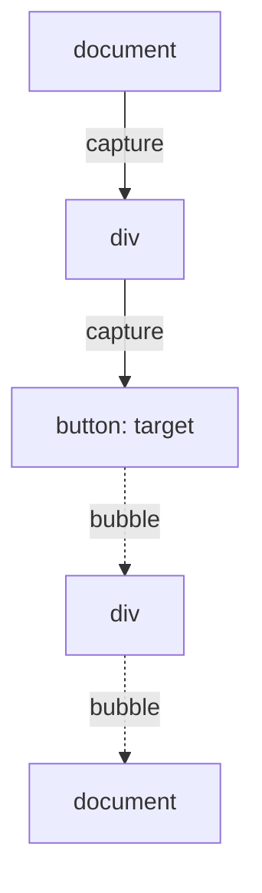

## What is an event?

An **event** is something that happens in the page: a click, a key press, the page finishing loading. JavaScript can **listen** for an event and run a function when it happens.

That function is called an **event handler** (or **listener**).

```html
<button id="hello">Say hello</button>

<script>
  const button = document.querySelector("#hello");

  button.addEventListener("click", () => {
    console.log("Hello!");
  });
</script>
```

Output (in the console, after you click):

```
Hello!
```

> 📝 Note: Save this as an `.html` file, open it in your browser, and open the console with F12 to see the output.

## Common events

| Event | When it happens | Typical element |
| --- | --- | --- |
| `click` | The user clicks (or taps) | buttons, links, anything |
| `input` | The value changes, on every key stroke | `<input>`, `<textarea>` |
| `change` | The value is "committed" (e.g. leaving the field, picking an option) | `<select>`, checkboxes, inputs |
| `submit` | A form is sent | `<form>` |
| `keydown` | A key is pressed down | `document`, inputs |
| `mouseover` | The mouse moves onto an element | anything |
| `load` | Everything (images, styles) has loaded | `window`, `` |
| `DOMContentLoaded` | The HTML is read and the DOM is ready | `document` |

## addEventListener

The modern way to listen is `element.addEventListener(type, handler)`.

```js
const box = document.querySelector("#box");

box.addEventListener("mouseover", () => {
  box.style.background = "gold";
});
```

You can add **many** listeners for the same event, and they all run.

```js
button.addEventListener("click", () => console.log("first"));
button.addEventListener("click", () => console.log("second"));
// click → first
//         second
```

## Avoid the onclick attribute

You may see old code that puts JavaScript inside the HTML:

```html
<!-- ❌ Old style: mixes HTML and JS -->
<button onclick="alert('Hi')">Click</button>
```

This works, but it mixes code into your HTML, and it only allows one handler. Prefer `addEventListener` in your script.

> 💡 Tip: The property `button.onclick = fn` is a bit better than the attribute, but setting it again **replaces** the old handler. `addEventListener` does not.

## The event object

Your handler receives an **event object** with details about what happened. By habit it is named `event` or `e`.

| Property / method | What it gives you |
| --- | --- |
| `event.type` | The event name, e.g. `"click"` |
| `event.target` | The element where the event started |
| `event.currentTarget` | The element the listener is attached to |
| `event.key` | The key pressed (keyboard events) |
| `event.preventDefault()` | Stops the browser's default action |

```js
document.addEventListener("keydown", (event) => {
  console.log(`You pressed ${event.key}`);
});
// press "a"     → You pressed a
// press Enter   → You pressed Enter
```

### preventDefault

Some events have a **default action**. A link opens a page; a form reloads the page. `preventDefault()` stops that.

```html
<a href="https://example.com" id="link">Go</a>

<script>
  document.querySelector("#link").addEventListener("click", (event) => {
    event.preventDefault();
    console.log("Link click blocked");
  });
</script>
```

## removeEventListener

To stop listening, call `removeEventListener` with the **same function**. So the function needs a name.

```js
function handleClick() {
  console.log("Clicked once, now I stop");
  button.removeEventListener("click", handleClick);
}

button.addEventListener("click", handleClick);
```

> ⚠️ Watch out: `removeEventListener("click", () => {...})` does nothing, because a new arrow function is a different function.

## Waiting for the page: DOMContentLoaded

If your script is in the `<head>`, the elements don't exist yet. Wait for `DOMContentLoaded`:

```js
document.addEventListener("DOMContentLoaded", () => {
  console.log("DOM is ready");
});
```

> 💡 Tip: Putting `<script defer src="app.js">` in the head, or your script at the end of `<body>`, also solves this.

## Bubbling and capturing

When you click a button inside a `<div>`, the click also happens on the div, the body and the document. The event travels in three phases:

1. **Capturing**: from the top (`document`) down to the target.
2. **Target**: it reaches the clicked element.
3. **Bubbling**: it goes back up through every parent.



By default, listeners run in the **bubbling** phase.

```html
<div id="outer">
  <button id="inner">Click me</button>
</div>

<script>
  document.querySelector("#outer").addEventListener("click", () => {
    console.log("div");
  });
  document.querySelector("#inner").addEventListener("click", () => {
    console.log("button");
  });
</script>
```

Output after clicking the button:

```
button
div
```

To listen in the capturing phase instead, pass `{ capture: true }` as a third argument. You rarely need it.

### stopPropagation

`event.stopPropagation()` stops the event from moving on to the parents.

```js
document.querySelector("#inner").addEventListener("click", (event) => {
  event.stopPropagation();
  console.log("button");
});
// click → button   (the div listener no longer runs)
```

> ⚠️ Watch out: Use `stopPropagation` sparingly. Other code (like analytics or a "close menu on outside click") may depend on bubbling.

## Event delegation

Because events bubble, you can put **one** listener on a parent and handle clicks on all its children. This is called **event delegation**. It also works for items you add later.

```html
<ul id="list">
  <li>Apples</li>
  <li>Bread</li>
  <li>Milk</li>
</ul>

<script>
  const list = document.querySelector("#list");

  list.addEventListener("click", (event) => {
    const item = event.target.closest("li");
    if (!item) return; // the click was not on an <li>
    item.classList.toggle("done");
    console.log(`Toggled: ${item.textContent}`);
  });

  // New items work too — no extra listener needed
  const li = document.createElement("li");
  li.textContent = "Eggs";
  list.append(li);
</script>
```

Clicking "Bread" prints `Toggled: Bread`.

> 📝 Note: `closest("li")` finds the nearest `<li>` from the target upward. It helps when the `<li>` contains other tags like `<span>`.

## Listener options: once and passive

The third argument can be an options object.

| Option | What it does |
| --- | --- |
| `once: true` | The listener runs one time, then removes itself |
| `passive: true` | Promises you won't call `preventDefault()`; makes scrolling smoother |
| `capture: true` | Listen during the capturing phase |

```js
button.addEventListener("click", () => console.log("Only once!"), { once: true });

window.addEventListener("scroll", () => {
  console.log(window.scrollY);
}, { passive: true });
```

## Try it yourself

1. Make a button that counts how many times it was clicked and shows the number on the button.

<details>
<summary>Show solution</summary>

```js
const btn = document.querySelector("#counter");
let count = 0;

btn.addEventListener("click", () => {
  count++;
  btn.textContent = `Clicked ${count} times`;
});
```
</details>

2. Show what the user types in an `<input id="name">` live inside a `<p id="preview">`.

<details>
<summary>Show solution</summary>

```js
const input = document.querySelector("#name");
const preview = document.querySelector("#preview");

input.addEventListener("input", (event) => {
  preview.textContent = event.target.value;
});
```
</details>

3. Log "Escape pressed" when the user presses the Escape key anywhere on the page.

<details>
<summary>Show solution</summary>

```js
document.addEventListener("keydown", (event) => {
  if (event.key === "Escape") {
    console.log("Escape pressed");
  }
});
```
</details>

## Quick check

<details>
<summary>What is the difference between event.target and event.currentTarget?</summary>

`target` is the element where the event started (what was actually clicked). `currentTarget` is the element whose listener is running right now.
</details>

<details>
<summary>Why does event delegation work?</summary>

Because events **bubble** up from the clicked element to its parents, so one listener on a parent sees clicks on all its children.
</details>

<details>
<summary>How do you stop a form from reloading the page?</summary>

Listen for `submit` on the form and call `event.preventDefault()`.
</details>

## Key takeaways

- An event is something that happens; a listener is a function that reacts to it.
- Use `addEventListener`, not `onclick` attributes in HTML.
- The event object gives you `target`, `key` and `preventDefault()`.
- Events bubble from the target up to its parents; `stopPropagation()` stops that.
- Event delegation: one listener on a parent handles many children.
- Options like `once` and `passive` make listeners simpler and faster.
