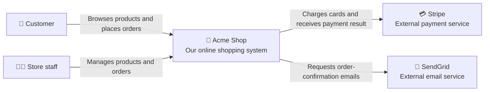
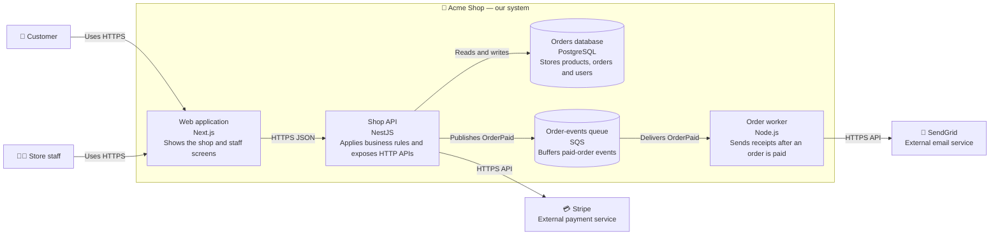
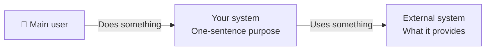
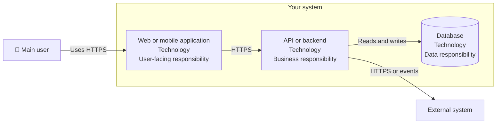

## The big idea

When someone asks, **"How does this system work?"**, a code repository is usually the wrong first answer. They need a map.

The **C4 model** is a simple way to make that map. It has four zoom levels. In this lesson, focus on the two that help most teams first:

| Diagram | Zoom level | One question it answers |
| --- | --- | --- |
| **System context** | Far away | Who uses our system, and what other systems does it depend on? |
| **Container** | One step closer | What are the major running applications and data stores inside our system? |

> 💡 A C4 **container is not necessarily a Docker container**. It means a separately running or separately deployed thing: a web app, API, database, queue, worker, or mobile app.

Think of a shopping mall:

- The **context diagram** shows the mall, shoppers, bank, delivery company and nearby roads.
- The **container diagram** opens the mall and shows the store, warehouse desk and payment desk.

Do not put classes, folders, endpoints or Kubernetes Pods in these two diagrams. That is too much detail for this zoom level.

## Why make both?

A context diagram helps product people, new developers and external partners agree on the **boundary**: what we own and what we merely integrate with.

A container diagram helps developers and operations people agree on **responsibilities**: where a request goes, where data lives, and what must be deployed or monitored.

| Situation | Diagram that answers it |
| --- | --- |
| "Does Stripe belong to our system?" | Context |
| "Which application sends the receipt email?" | Container |
| "What must change if we replace the payment provider?" | Both |
| "Which class validates a coupon?" | Neither — use a component or code diagram later |

These diagrams prevent a common mistake: calling every dependency "our architecture". Stripe, an email provider and a customer browser affect your system, but they are **outside** its ownership boundary.

---

## One practical example: an online shop

Our example is **Acme Shop**. Customers browse products and place orders. Staff manage products. The shop charges cards through Stripe and sends receipts through SendGrid.

Before drawing, write the scope in one sentence:

> **Acme Shop lets customers buy products online and lets staff manage the catalogue and orders.**

That sentence is important. Every box in the diagram should help explain it.

## 1. C4 system-context diagram

### What to include

Include only:

1. **People** who use the system.
2. **One box for the system you are describing.**
3. **External software systems** it communicates with.
4. **Labeled relationships** explaining why they communicate.

For Acme Shop, this is enough:

Read it aloud:

> Customers and staff use Acme Shop. Acme Shop uses Stripe to charge cards and SendGrid to send email.

If that sentence is clear, the diagram is doing its job.

### What this diagram deliberately hides

It does **not** show React, Node.js, Postgres, Redis, endpoints, queues or tables. Those details are real, but they make the boundary hard to see. Put them in the next diagram.

---

## 2. C4 container diagram

Now keep the same system boundary but open it up. Show the major things that run inside Acme Shop and how they connect.

### What to include

For each container, add:

- a clear **name** — such as `Web application` or `Shop API`;
- its **technology** only if it helps — such as `Next.js`, `NestJS`, or `PostgreSQL`;
- one short **responsibility**;
- the important connections, labeled with protocol or purpose where useful.

This diagram answers practical questions:

- The browser never talks directly to PostgreSQL.
- The API owns the business rules and payment call.
- A queue separates paying for an order from sending its email, so a slow email provider does not keep the customer waiting.
- The worker is a separate deployable container even though it uses the same programming language as the API.

## Context vs container: the same story at two zoom levels

| In the context diagram | In the container diagram |
| --- | --- |
| `Acme Shop` is one box | `Web application`, `Shop API`, `Orders database`, `Order worker` and `Order-events queue` are inside that box |
| Stripe is external | Stripe is still external; now we can see that the **Shop API** calls it |
| SendGrid is external | SendGrid is still external; now we can see that the **Order worker** calls it |
| Customer uses Acme Shop | Customer uses the **Web application** over HTTPS |

The outside world should stay almost the same. The main difference is that the single **system** box has been expanded into its internal containers.

---

## An easy five-step method you can reuse

### Draw the context diagram

1. Write the system name and one-sentence purpose in the middle.
2. List the people who use it.
3. List external systems it calls or that call it.
4. Draw one arrow per meaningful relationship.
5. Put a short verb on every arrow: `places orders`, `charges card`, `sends email`.

### Draw the container diagram

1. Copy the people and external systems from the context diagram.
2. Replace your one system box with its major applications, data stores and asynchronous workers.
3. Give every container one responsibility; if a box needs a paragraph, split or simplify it.
4. Label important connections with a protocol or event: `HTTPS`, `SQL`, `publishes OrderPaid`.
5. Ask a teammate to trace one real journey, such as "customer places an order." If they cannot trace it, improve the labels before adding more boxes.

## A blank starting template

Copy this into any Mermaid-compatible Markdown file and replace the names. The site renders Mermaid diagrams directly, so you can also use it in a new course lesson.

Then expand only `Your system` for the container diagram:

## Common mistakes

| Mistake | Better choice |
| --- | --- |
| Calling every Docker process a container | Group processes by meaningful responsibility and deployability, not by implementation accident |
| Showing every database table | One database container is enough at this level; show schemas or tables later only when needed |
| Putting Stripe inside your system boundary | Keep it outside unless your team owns and operates it |
| Unlabeled arrows | Write what flows across the connection: `creates order`, `HTTPS`, `OrderPaid` |
| Starting with a perfect diagram | Start with 5–10 boxes. A diagram that is current and understandable beats a complete diagram nobody reads |

## When to update the diagrams

Update the **context** diagram when users, ownership boundaries or external integrations change. Update the **container** diagram when you add or remove a deployable application, database, queue, or major communication path.

Keep both beside the code — for example, in `docs/architecture/` — and review them in the pull request that changes the architecture. They are living documentation, not a one-time presentation slide.

## Key takeaways

- A **system-context diagram** shows your system as one box, its users and its external neighbours.
- A **container diagram** zooms into that one box to show the main applications, databases, queues and workers.
- A C4 container is a separately running responsibility, **not automatically a Docker container**.
- Use the same example and system boundary in both diagrams; the second diagram simply adds one more level of detail.
- Start with the five-step method, short labels and a real user journey. That is enough to make a useful first version.
