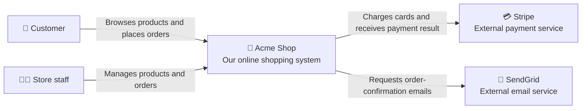
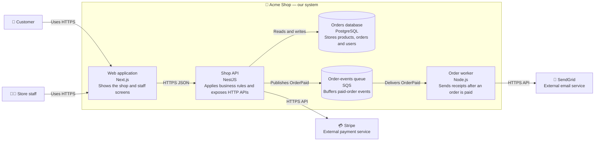
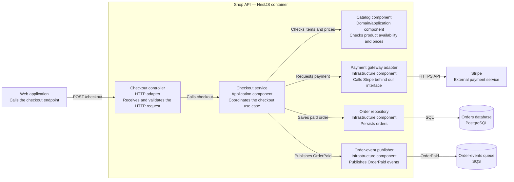
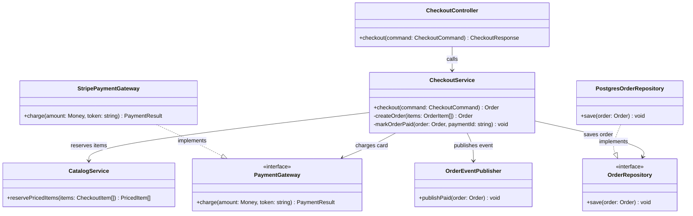
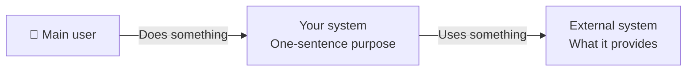
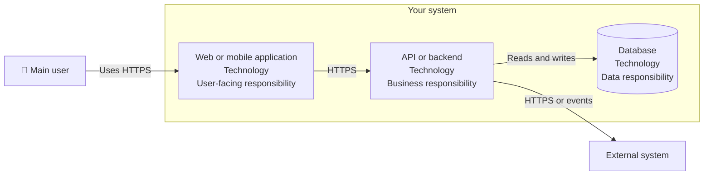
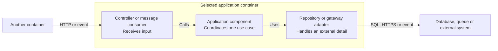

## The big idea

When someone asks, **"How does this system work?"**, a code repository is usually the wrong first answer. They need a map.

The **C4 model** is a simple way to make that map. It has four zoom levels. Each level answers a different question, so readers can stop when they have enough detail:

| Diagram | Zoom level | One question it answers |
| --- | --- | --- |
| **System context** | Far away | Who uses our system, and what other systems does it depend on? |
| **Container** | One step closer | What are the major running applications and data stores inside our system? |
| **Component** | Inside one container | Which important modules collaborate inside this application? |
| **Code** | Closest | How is one component structured in classes, functions or packages? |

> 💡 A C4 **container is not necessarily a Docker container**. It means a separately running or separately deployed thing: a web app, API, database, queue, worker, or mobile app.

Think of a shopping mall:

- The **context diagram** shows the mall, shoppers, bank, delivery company and nearby roads.
- The **container diagram** opens the mall and shows the store, warehouse desk and payment desk.

Do not put classes, folders, endpoints or Kubernetes Pods in the first two diagrams. That is too much detail for those zoom levels. Component and code diagrams give that detail a home later in the lesson.

## Why make both?

A context diagram helps product people, new developers and external partners agree on the **boundary**: what we own and what we merely integrate with.

A container diagram helps developers and operations people agree on **responsibilities**: where a request goes, where data lives, and what must be deployed or monitored.

| Situation | Diagram that answers it |
| --- | --- |
| "Does Stripe belong to our system?" | Context |
| "Which application sends the receipt email?" | Container |
| "What must change if we replace the payment provider?" | Both |
| "Which module owns the checkout rules?" | Component |
| "Which method validates a coupon?" | Code |

These diagrams prevent a common mistake: calling every dependency "our architecture". Stripe, an email provider and a customer browser affect your system, but they are **outside** its ownership boundary.

---

## One practical example: an online shop

Our example is **Acme Shop**. Customers browse products and place orders. Staff manage products. The shop charges cards through Stripe and sends receipts through SendGrid.

Before drawing, write the scope in one sentence:

> **Acme Shop lets customers buy products online and lets staff manage the catalogue and orders.**

That sentence is important. Every box in the diagram should help explain it.

## 1. C4 system-context diagram

### What to include

Include only:

1. **People** who use the system.
2. **One box for the system you are describing.**
3. **External software systems** it communicates with.
4. **Labeled relationships** explaining why they communicate.

For Acme Shop, this is enough:

Read it aloud:

> Customers and staff use Acme Shop. Acme Shop uses Stripe to charge cards and SendGrid to send email.

If that sentence is clear, the diagram is doing its job.

### What this diagram deliberately hides

It does **not** show React, Node.js, Postgres, Redis, endpoints, queues or tables. Those details are real, but they make the boundary hard to see. Put them in the next diagram.

---

## 2. C4 container diagram

Now keep the same system boundary but open it up. Show the major things that run inside Acme Shop and how they connect.

### What to include

For each container, add:

- a clear **name** — such as `Web application` or `Shop API`;
- its **technology** only if it helps — such as `Next.js`, `NestJS`, or `PostgreSQL`;
- one short **responsibility**;
- the important connections, labeled with protocol or purpose where useful.

This diagram answers practical questions:

- The browser never talks directly to PostgreSQL.
- The API owns the business rules and payment call.
- A queue separates paying for an order from sending its email, so a slow email provider does not keep the customer waiting.
- The worker is a separate deployable container even though it uses the same programming language as the API.

## Context vs container: the same story at two zoom levels

| In the context diagram | In the container diagram |
| --- | --- |
| `Acme Shop` is one box | `Web application`, `Shop API`, `Orders database`, `Order worker` and `Order-events queue` are inside that box |
| Stripe is external | Stripe is still external; now we can see that the **Shop API** calls it |
| SendGrid is external | SendGrid is still external; now we can see that the **Order worker** calls it |
| Customer uses Acme Shop | Customer uses the **Web application** over HTTPS |

The outside world should stay almost the same. The main difference is that the single **system** box has been expanded into its internal containers.

---

## 3. C4 component diagram

A component diagram zooms into **one container**, not the entire system. Choose a container where a developer needs help understanding internal responsibilities. In Acme Shop, that is the `Shop API`.

### What is a component?

In C4, a component is a meaningful grouping of code behind a clear responsibility and interface. It might be a NestJS module, a feature slice, a package or a service class. It is **not automatically every file or class**.

For this API, a useful component diagram answers: “When checkout happens, which parts of the API collaborate?”

### How to read it

Trace one journey from left to right:

1. The web application sends `POST /checkout` to the controller.
2. The controller turns the HTTP request into a call to `Checkout service`.
3. The checkout service coordinates the use case: it checks the catalogue, asks the payment adapter to charge the card, saves the order and publishes an event.
4. The adapter, repository and publisher handle the details of Stripe, PostgreSQL and SQS.

This makes an important design decision visible: checkout business rules do not need to know Stripe's HTTP format or PostgreSQL's SQL. Those details live at the edges, behind components with focused responsibilities.

### What belongs here—and what does not

| Include | Leave out |
| --- | --- |
| Components with a distinct responsibility | Every helper file, DTO or utility function |
| Interfaces to external systems, databases or queues | Private methods and local variables |
| Important inbound adapters, such as an HTTP controller or message consumer | Framework plumbing that does not change the architecture |
| Relationships that explain a real request or event path | Every possible call path in the container |

Use a component diagram when the container is important enough that “the API handles it” is no longer an adequate explanation. Do not create one for a tiny CRUD service whose structure is obvious from a few files.

---

## 4. C4 code diagram

The code diagram is the closest zoom level. It explains the implementation inside **one component**—here, the `Checkout service`. It can show classes, interfaces, functions, packages or aggregates, depending on the language and team conventions.

Because code changes often, Level 4 is optional. Prefer source navigation and tests for ordinary code. Draw it when the internal design is genuinely hard to understand, risky to change, security-sensitive or shared by several teams.

This diagram is not a full copy of the source code. It records the **stable shape** that matters to a maintainer:

- `CheckoutService` owns the checkout orchestration.
- It depends on `PaymentGateway` and `OrderRepository` interfaces, not Stripe or PostgreSQL directly.
- `StripePaymentGateway` and `PostgresOrderRepository` are replaceable infrastructure implementations.
- Tests can substitute fake implementations of those interfaces to exercise checkout rules without charging a card or using a real database.

### Good reasons to create a code diagram

- An authentication, payment, pricing or permissions component has important security boundaries.
- A domain model has non-obvious invariants, such as “an order cannot be paid twice.”
- Multiple teams implement adapters against a shared interface.
- A complex algorithm or workflow needs a compact map before a risky change.

Avoid a Level 4 diagram for every class. A stale class diagram is worse than no diagram because it sends maintainers in the wrong direction. Keep it close to the code it describes, and update it in the same pull request as a structural change.

## The full C4 zoom path

| Start with this question | Use this level | Stop when the reader can… |
| --- | --- | --- |
| Who uses the system, and what is outside our ownership? | **1. System context** | Understand scope and external dependencies |
| What applications, data stores and workers run inside it? | **2. Container** | Trace a request across deployable parts |
| Which modules collaborate inside one important application? | **3. Component** | Find the responsible module and its collaborators |
| How is one complex module implemented? | **4. Code** | Change the internals safely |

Start at Level 1 and zoom only when the current diagram no longer answers the reader's question. Most teams need Levels 1 and 2 for every meaningful system, Level 3 for selected important containers, and Level 4 only for selected complex components.

---

## An easy five-step method you can reuse

### Draw the context diagram

1. Write the system name and one-sentence purpose in the middle.
2. List the people who use it.
3. List external systems it calls or that call it.
4. Draw one arrow per meaningful relationship.
5. Put a short verb on every arrow: `places orders`, `charges card`, `sends email`.

### Draw the container diagram

1. Copy the people and external systems from the context diagram.
2. Replace your one system box with its major applications, data stores and asynchronous workers.
3. Give every container one responsibility; if a box needs a paragraph, split or simplify it.
4. Label important connections with a protocol or event: `HTTPS`, `SQL`, `publishes OrderPaid`.
5. Ask a teammate to trace one real journey, such as "customer places an order." If they cannot trace it, improve the labels before adding more boxes.

### Draw a component or code diagram only when needed

1. Choose **one** container (Level 3) or **one** component (Level 4); do not redraw the whole system.
2. Start from a real request, event or maintenance task that readers must understand.
3. Show only the responsibilities and dependencies that matter to that journey.
4. Label interfaces and boundaries, especially database, queue and external-service adapters.
5. Compare the diagram with the source and a focused test before merging; remove it if the code is simpler to read directly.

## A blank starting template

Copy this into any Mermaid-compatible Markdown file and replace the names. The site renders Mermaid diagrams directly, so you can also use it in a new course lesson.

Then expand only `Your system` for the container diagram:

For a component diagram, draw only the selected container and its immediate collaborators:

## Common mistakes

| Mistake | Better choice |
| --- | --- |
| Calling every Docker process a container | Group processes by meaningful responsibility and deployability, not by implementation accident |
| Showing every database table | One database container is enough at this level; show schemas or tables later only when needed |
| Putting Stripe inside your system boundary | Keep it outside unless your team owns and operates it |
| Unlabeled arrows | Write what flows across the connection: `creates order`, `HTTPS`, `OrderPaid` |
| Making each source file a component | Group code by a meaningful responsibility and interface; a component can contain many files |
| Treating a class diagram as a code inventory | Show stable responsibilities and dependencies, not every property and method |
| Drawing Level 4 before readers need it | Start at the widest useful level and zoom only for complex or risky areas |
| Starting with a perfect diagram | Start with 5–10 boxes. A diagram that is current and understandable beats a complete diagram nobody reads |

## When to update the diagrams

Update the **context** diagram when users, ownership boundaries or external integrations change. Update the **container** diagram when you add or remove a deployable application, database, queue, or major communication path.

Update a **component** diagram when an important module boundary or dependency changes. Update a **code** diagram when the documented internal structure changes. If keeping a Level 4 diagram current costs more than reading the source, delete it and keep the Level 3 diagram instead.

Keep both beside the code — for example, in `docs/architecture/` — and review them in the pull request that changes the architecture. They are living documentation, not a one-time presentation slide.

## Key takeaways

- A **system-context diagram** shows your system as one box, its users and its external neighbours.
- A **container diagram** zooms into that one box to show the main applications, databases, queues and workers.
- A **component diagram** zooms into one container to show the modules that collaborate on an important responsibility.
- A **code diagram** zooms into one complex component to show stable classes, interfaces, packages or functions.
- A C4 container is a separately running responsibility, **not automatically a Docker container**.
- Use the same example and system boundary as you zoom in; each level adds only the detail needed to answer the next question.
- Start with short labels and a real user journey. Add Levels 3 and 4 only where they make a difficult part easier to change safely.
