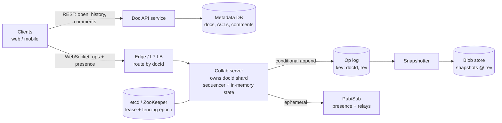

## The story in one minute

Alice and Bob are editing the **same paragraph** of a shared document. Bob is on a train with no internet, but he keeps typing. Meanwhile, the server that puts everyone's edits in order crashes, and a new server takes over.

Here is what can go wrong, step by step:

1. Alice types "Hello" at the start of the paragraph. Bob (offline) deletes the first word of the same paragraph.
2. The ordering server crashes. A backup server takes over and starts accepting edits.
3. The old server was only *frozen*, not dead. It wakes up and keeps writing edits too. Now **two servers** each think they own the document, and they write conflicting versions.
4. Bob's train reaches a station. His laptop reconnects and sends all his edits, including some the server already saved before he lost signal. If the server applies those twice, his text appears twice.

Result: Alice and Bob see **different text**, and some edits are lost or doubled. This lesson is about making sure everyone always ends up with the same document and no saved edit ever disappears.

## Words you need

| Word | Plain meaning | Everyday example |
| --- | --- | --- |
| **Operation (op)** | One small edit: "insert 'H' here" or "delete these 3 characters". | One line in a list of changes you made to a recipe. |
| **Sequencer** | The one server that puts a document's edits in a single order and numbers them. | The ticket machine at a deli counter: each customer gets the next number. |
| **Op log** | A permanent, append-only list of every edit, in order. | A bank statement: every transaction, never erased. |
| **Snapshot** | A saved copy of the whole document at one edit number. | A photo of a whiteboard, so you don't have to replay every marker stroke. |
| **OT / CRDT** | Two ways of merging edits that happen at the same time so everyone ends up with the same text. | Two people editing a shared shopping list and agreeing on the final list. |
| **Fencing epoch** | A number that goes up each time a new server takes ownership. Old numbers are refused. | Changing the locks when a tenant moves out: the old key no longer works. |
| **Presence** | Live "who is here and where is their cursor" information. | Seeing who is in a meeting room through the glass. You don't write it in the minutes. |
| **Idempotent** | Doing it twice has the same effect as doing it once. | Pressing a lift button twice: the lift still comes once. |

## The fix in four rules

### Rule 1: Give every edit a name tag

Each edit carries `(clientId, clientSeq)`: "this is edit #118 from laptop c42". If the same edit arrives twice, the server sees the same name tag and ignores the copy.

❌ **Wrong:** edits have no ID. After a reconnect, Bob resends 20 edits and 15 of them get applied a second time.

✅ **Right:** the server remembers which `(clientId, clientSeq)` pairs it already accepted. Resending is always safe.

### Rule 2: One owner per document, and save before you say "got it"

Each document has exactly **one** sequencer at a time. It numbers each edit (`rev` 9034, 9035, ...), writes it to the op log, and **only then** tells the author "saved" (this reply is an **ack**, short for acknowledgement).

❌ **Wrong:** ack first, save later. If the server crashes in between, the user was told "saved" but the edit is gone.

✅ **Right:** durable write first, then ack, then send the edit to everyone else.

### Rule 3: Use a fence when ownership changes

When a new server takes over a document, it gets a **higher epoch** number (say epoch 8 instead of 7). The storage itself refuses any write that carries an older epoch. So if the old server wakes up and tries to write with epoch 7, the write simply fails.

❌ **Wrong:** "the old server will notice it lost ownership". A frozen server cannot notice anything until it is already writing.

✅ **Right:** the **storage** checks the fence, so a zombie (a server that thinks it is still in charge but isn't) can't do damage.

### Rule 4: Keep cursors out of storage

Cursor moves and "Alice is viewing" are sent live and then forgotten. They happen about **10 times more often** than real edits and are useless a second later. Saving them would waste storage for nothing.

## Walk through a failure

The old sequencer was paused (for example by a long garbage-collection pause, when the program stops briefly to clean up memory). A new owner took over with epoch 8. Now the old one wakes up:

1. The old server tries to append rev 9036 with epoch 7.
2. Storage sees "current epoch for this doc is 8" and **rejects** the write. It also can't reuse a `rev` number that already exists.
3. The old server gets an error, realizes it lost ownership, and stops.

Meanwhile Bob reconnects:

1. Bob's laptop says "the last edit I know was saved is rev 9031" (`lastAckedRev`).
2. The new owner sends him every edit after rev 9031.
3. Bob resends all edits that were never acked. The ones the server already had (same name tag) are dropped. The new ones are merged in.
4. Everyone ends up with the same text. Nothing doubled, nothing lost.

## How to prove it works

Test these cases on purpose, then check the results:

1. **Same-moment edits:** two users insert and delete at the same spot. Every copy of the document must end up identical.
2. **Duplicate edits:** resend the same edit 5 times. It must be applied once.
3. **Offline merge:** edit offline for an hour, then reconnect. The merge must succeed and nothing acked may be lost.
4. **Leader loss:** kill the sequencer, and also freeze it and wake it up later. No acked edit lost, no two edits with the same `rev`.
5. **Measure:** how long edits take to reach others (sync lag), and how long recovery from a snapshot takes.

### Check your understanding

Which part of a cursor update needs durable storage (saved to disk so it survives a crash), if any?

<details>
<summary>Show answer</summary>

**None of it.** A cursor position is presence: it is only useful right now, and the next update replaces it a few milliseconds later. If the server crashes, clients simply send their cursor again. It is sent through pub/sub and thrown away, never written to the op log.

(Note the difference with **comments**: a comment's anchor *is* stored, because a comment must survive. Both use stable character IDs rather than plain positions, but only the comment is durable.)

</details>

---

## Going deeper

`Per-Doc Sequencer` · `OT / CRDT` · `Op Log + Snapshots` · `Ephemeral Presence`

## The full problem

> Design a real-time collaborative document editor like Google Docs. Many users edit the same document at once and see each other's changes and cursors within ~100 ms. Edits must never be lost. Users can go offline, keep editing, and merge cleanly when they come back. Users can browse version history and restore old versions.

**What a senior (L6) answer looks like:** you lead the scoping, choose how to merge edits and defend that choice, spot the tricky parts yourself (very busy documents, sequencer failover, long offline sessions), and talk about running the system day to day, not just drawing boxes.


## 1. Requirements

**What it must do (functional)**

1. Create, open and edit rich-text documents (bold, lists, headings and so on).
2. When N users edit at the same time, everyone ends up with the same text.
3. Live cursors, selections and presence ("Alice is viewing").
4. Offline editing, merged when you reconnect.
5. Version history and restore.
6. Comments and permissions (owner, editor, commenter, viewer).

**How well it must do it (non-functional)**

| Property | Target | In plain words |
| --- | --- | --- |
| Edit propagation latency | p99 < 200 ms in-region | 99 out of 100 edits reach others within 0.2 s. |
| Durability | An acked edit is never lost (RPO = 0) | RPO (recovery point objective) = how much data you may lose. Here: zero. |
| Convergence | Every copy ends up identical | No user sees different text once edits settle. |
| Availability | 99.99% for editing | About 4 minutes of editing downtime a month. |
| Hot doc | 100 editors + 10k viewers at once | One very popular document must still work. |

**Out of scope (say it out loud):** spreadsheet and slide engines, full-text search, page rendering and layout.

## 2. Quick size estimate

```text
DAU                          : 50M
Peak concurrent docs open    : 5M
Peak active typists          : 3M
Ops/sec per typist (batched) : ~2    (client batches keystrokes every 50–100 ms)
Peak write ops/sec           : ~6M ops/s
Avg op size (with metadata)  : ~150 B  -> ~900 MB/s ingest
Raw op log per day           : ~25–40 TB/day before compaction
Snapshot size (avg doc)      : ~50 KB; 5B docs -> ~250 TB of snapshots
Cursor/presence messages     : ~10x op volume, but EPHEMERAL (never stored)
```

How to read this:

- **DAU** = daily active users. 50 million people use it each day.
- The app doesn't send one message per key press. It **bundles** keys typed in the last 50 to 100 ms, so a fast typist sends about 2 messages a second. 3M typists × 2 = **6M edits a second**.
- 6M × 150 bytes ≈ **900 MB per second** arriving. Traffic is lower outside peak hours, so a day adds roughly 25 to 40 TB of raw log.

**Takeaway:** the total is big, but it is spread over **millions of small, separate documents**. That splits nicely: each server handles its own set of documents, chosen by `docId` (this is called **sharding**). The hard parts are **keeping edits in order inside one document** and **very popular documents**, not the total volume.

## 3. The big choice: OT or CRDT

Both solve the same puzzle: Alice inserts at position 5 while Bob deletes position 3. Whose "position 5" is right?

- **OT (Operational Transformation):** a central server decides an order, then **adjusts** ("transforms") later edits so they still make sense. If Bob deleted 1 character before Alice's spot, Alice's "insert at 5" becomes "insert at 4".
- **CRDT (Conflict-free Replicated Data Type):** every character gets a **permanent unique ID**. Edits say "insert after character `c7#55`", not "insert at position 5". Because IDs never shift, edits can be merged in **any order** and still give the same result.

| | OT (Operational Transformation) | CRDT (Yjs / Automerge / Fugue) |
| --- | --- | --- |
| Needs a central order? | Yes, a per-doc sequencer | No, edits merge in any order |
| Extra data stored | Small (ops carry a position) | Larger (an ID per character, plus tombstones) |
| Offline / peer-to-peer | Weak: long chains of adjustments | Strong: merge at any time |
| Rich text and user intent | Mature (Google Docs) | Good now (Peritext, Yjs) |
| Server complexity | Transform logic lives on the server | Server can just relay and save |

A **tombstone** is a marker left behind when a character is deleted: "character `c7#55` was here but is deleted". CRDTs keep them so late-arriving edits that point at that character still know where to go.

**Recommendation:** use a **server-ordered design with one writer per document**, and use **CRDT merge rules** for the document content. You get the best of both:

- The sequencer gives **one agreed order**, an always-increasing `rev` number, a simple durable log and cheap version history ("show me the document at rev 9000").
- CRDT rules make **offline merge** and reconnect easy (no long chains of N×M adjustments), and copies still agree even if messages arrive out of order.
- The cost is extra metadata. We handle it with **periodic compaction**: snapshots clean out old tombstones.

> If the interviewer asks for "online only, minimal storage", **pure OT with a central server** (the Jupiter model) is also a fine answer. State the trade-off and move on.

## 4. High-level architecture

In words: clients keep a live **WebSocket** (a connection that stays open so the server can push messages any time) for edits and cursors, and use normal REST calls for opening documents, history and comments. A load balancer sends each document to the server that owns it. That server orders edits, saves them to the op log and passes them on.



- **etcd / ZooKeeper:** a small, very reliable service that decides "who owns which document right now" and hands out the epoch numbers.
- **Pub/Sub:** a broadcast system. Publish once, every subscriber receives it.
- **Blob store:** cheap storage for big files (like S3), used for snapshots.

## 5. API and protocol

```http
GET  /docs/{docId}                 -> { snapshot, snapshotRev, opsSince[], acl }
GET  /docs/{docId}/history?before= -> [ { rev, author, ts, summary } ]
POST /docs/{docId}/restore         -> { rev }
WS   /docs/{docId}/stream
```

The messages sent over the WebSocket:

```jsonc
// client -> server
{ "type": "op", "clientId": "c42", "clientSeq": 118, "baseRev": 9031,
  "ops": [ /* CRDT update or OT ops */ ] }
{ "type": "presence", "cursor": { "anchor": "id:c7#55", "head": "id:c7#60" } }

// server -> client
{ "type": "ack", "clientSeq": 118, "rev": 9034 }
{ "type": "remote_op", "rev": 9035, "author": "c19", "ops": [ ... ] }
{ "type": "presence", "user": "u19", "cursor": { ... } }   // throttled to 50 ms
```

- `baseRev` = "I made this edit while looking at rev 9031".
- `ack` = "your edit #118 is saved as rev 9034".
- `remote_op` = "here is someone else's edit".

`(clientId, clientSeq)` makes every edit **idempotent**, so resending after a reconnect is always safe.

## 6. Data model

```sql
-- Metadata DB
docs(doc_id PK, owner_id, title, created_at, latest_rev, latest_snapshot_rev, epoch)
acl(doc_id, principal_id, role)            PRIMARY KEY (doc_id, principal_id)
comments(doc_id, comment_id, anchor_id, body, author, resolved)

-- Op log (wide-column: partition = doc_id, clustering = rev)
ops(doc_id, rev, client_id, client_seq, author, ts, payload BLOB)
     PRIMARY KEY ((doc_id), rev)

-- Blob store
snapshots/{doc_id}/{rev}.bin   -- compacted CRDT state, tombstones GC'd
```

- **ACL** (access control list) = who may do what with this document.
- The op log uses a **wide-column** database (like Cassandra): all edits of one document live together, sorted by `rev`, so "give me everything after rev 9031" is one quick read.

Comment anchors use **CRDT character IDs**, not positions like "character 120". If someone types above the comment, position 120 now points at the wrong word, but the ID still points at the right one.

## 7. Write path (what happens when you type)

1. Your app applies the edit **to your own screen immediately** (this is called *optimistic*: assume it will succeed). Typing feels instant.
2. It sends `{clientId, clientSeq, baseRev, ops}` over the WebSocket.
3. The edge sends it to the **collab server that owns this `docId`** (found with consistent hashing, a way of spreading keys over servers, plus a registry of who holds which lease).
4. The sequencer checks the name tag `(clientId, clientSeq)` to drop duplicates, then merges the edit into the document it holds in memory.
5. It sets `rev = lastRev + 1` and does a **conditional append** (write only if this `rev` doesn't exist yet):
   ```sql
   INSERT INTO ops (doc_id, rev, ...) VALUES (...) IF NOT EXISTS
   ```
6. **Only after that write is safely stored** does it send `ack{rev}` to you and `remote_op` to everyone else.
7. Every N edits (for example 1,000) or every T minutes, the snapshotter saves a compacted snapshot. Old log pieces move to cheaper, slower "cold" storage.

**Opening a document:** load the latest snapshot (say at rev 9000), replay the edits `WHERE rev > 9000`, then subscribe to the live stream. That's much faster than replaying all edits since the document was created.

## 8. Deep dives (where a senior answer stands out)

### A. Sequencer failover without "split-brain"

**Split-brain** = two servers both believe they are in charge, and both write. Here's how we prevent it:

- Each collab server holds a **lease** (a time-limited ownership, like a parking ticket that expires) on its documents in etcd, and gets a **fencing epoch** number.
- The danger: a server frozen by a garbage-collection pause or cut off by a network split can wake up and keep writing **after** a new owner took over.
- **Defence 1:** the conditional append on `(docId, rev)` means two writers can never both save the same `rev`.
- **Defence 2:** the log refuses writes whose `epoch` is lower than the document's current epoch. This second check matters: without it, a zombie could still slip in a *new* `rev` number the new owner hasn't used yet.
- **Recovery:** the new owner loads the snapshot plus the log after it. Clients reconnect with `lastAckedRev` and resend unacked edits. Name tags drop the duplicates.
- Failover takes about one lease length (5 to 10 seconds). Clients keep typing locally the whole time, so users barely notice.

### B. Hot documents (100 editors + 10k viewers)

- **Editors** stay on the single sequencer: 100 writers × 2 edits/s = **200 edits/s**. One process handles that easily.
- **Viewers** never touch the sequencer. Use **tiered fan-out** ("fan-out" = sending one message to many receivers): the sequencer sends each edit to a few **relay nodes**, and each relay pushes it to thousands of read-only connections. Like a teacher telling 10 group leaders, who each tell their group.
- **Presence:** send at most one cursor update per user every 50 ms, merge rapid moves into one, and for big audiences show "+9,800 viewers" instead of drawing every cursor (**lazy presence**).

### C. Offline editing and long breaks

- The app keeps its own CRDT copy plus a queue of unacked edits in IndexedDB (a database built into the browser), so nothing is lost if the tab closes.
- On reconnect it sends a **state vector**: "from each client, I've seen up to edit X". Example: `{c19: 400, c42: 118}`. The server replies with only what's missing, and the client sends its own new edits. CRDT merges in any order, so there's no explosion of adjustments.
- **Guardrails:**
  - If the document was compacted past where the client started (the tombstones it needs are gone), do a **full-state merge** instead of sending only the missing edits.
  - If the user lost access while offline, **reject the edits but keep a local copy** they can export. Never silently throw away their work.

### D. Storage growth and compaction

- In a simple CRDT, tombstones pile up forever. A document typed and deleted many times can be mostly tombstones.
- Snapshots **remove tombstones that every live client has already seen** (the smallest state vector among active clients). A client older than that does a full resync.
- History: keep the detailed op log for 30 days, then **keep only hourly checkpoints** in cold storage.

### E. Security and permissions

- Check permissions when the WebSocket connects, **and** cache them on the collab server for a short time (short TTL, "time to live").
- When access is removed, the metadata service publishes an event and the collab server **closes that socket right away**, so the short cache doesn't leave a gap.
- Check every edit on the server (a viewer sending edits is rejected) and limit how many edits per second one user may send.

### F. Undo

Undo is **per user**, not for the whole document. Ctrl-Z undoes *my* last change by creating a new "opposite" edit against the current text. It never rolls the whole document back to an old `rev`, because that would also wipe out other people's recent work.

## 9. Failure modes

| Failure | What users see | Fix |
| --- | --- | --- |
| Collab server crash | Edits pause ~5–10 s | Lease expires → new owner, clients resend |
| Zombie old owner | Duplicate or forked revs | Fencing epoch + conditional append |
| Op log region outage | No acks | Log copied across regions; clients keep edits locally |
| Network flap (quick drop and reconnect) | Duplicate edits | `(clientId, clientSeq)` idempotency |
| Broken or malicious edit | Corrupt document | Server-side validation and format checks |
| Merge bug | Users see different text | Regular **checksum** of the document in acks; auto-resync if it doesn't match |

A **checksum** is a short fingerprint of the text. If my fingerprint and the server's differ, our documents differ.

## 10. Interviewer follow-ups

1. **Why not let every server accept writes for a document?** Several writers for one document would need to agree (consensus) on every keystroke, which is slow and complicated. One writer with fast, fenced failover is simpler and meets the latency target.
2. **How do you go multi-region?** Give each document a "home" region near most of its editors. Far-away users wait longer for acks (cross-region round trip), but they still type locally with no lag. Move the home if most editors move.
3. **How do you notice copies drifting apart in production?** Every K revs the server sends a rolling hash (fingerprint) of the document. The client compares, reports a mismatch to monitoring, and resyncs.
4. **What changes for a 1 GB document?** Split it into **sections/blocks**, each with its own CRDT and loaded only when needed, so the sequencer only keeps the active blocks in memory.

## Summary

**Split by `docId` with one fenced writer per document. Give each document a durable, ordered op log plus snapshots. Use CRDT merging so offline edits combine cleanly. Keep presence temporary, and use relays for very popular documents.**

**Watch on the dashboard:** ack p99, how long failover takes, checksum mismatches, op-log write latency, how far snapshots lag behind, and the share of tombstones per document.

## Quick recap

- 🏷️ **Name every edit** with `(clientId, clientSeq)` so resends are harmless.
- 🎫 **One sequencer per document** numbers edits; save first, ack second.
- 🔒 **Fencing epochs** checked by storage stop a zombie owner from writing.
- 🔀 **CRDT merge** makes offline edits and reconnects simple; snapshots clean up tombstones.
- 👀 **Cursors and presence** are live only, never stored.
