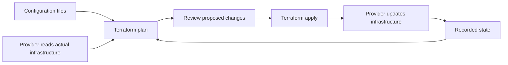

## What Terraform does

Terraform manages infrastructure through configuration files. Instead of clicking through a cloud console to create a network, server, and database, you describe those resources in code and review the proposed changes before making them.

Think of a house blueprint. The blueprint describes the intended house; a survey records what exists; a construction plan explains what must change. Terraform's configuration, state, and plan play similar roles.

Terraform talks to services through **providers**. AWS, Azure, Google Cloud, Kubernetes, GitHub, and local files have providers. The core workflow is similar, but each provider exposes its own resource types and arguments.

Terraform reconciles infrastructure when you run it. It does not continuously watch resources like a Kubernetes controller.

## The essential vocabulary

| Term | Meaning | Example |
| --- | --- | --- |
| Resource | Something Terraform manages | An S3 bucket |
| Data source | A read of existing information | An existing VPC |
| Provider | Plugin that talks to an API | `hashicorp/aws` |
| State | Mapping between resource addresses and real objects | `aws_s3_bucket.assets` → a bucket ID |
| Plan | Proposed operations | Add one bucket, change its tags |
| Module | A directory of Terraform configuration | Reusable private storage module |
| Backend | Where state is stored and how it is accessed | Local disk or S3 |

## Follow this learning path

1. **Beginner, lessons 1–5:** understand the workflow, run a local lab, learn HCL and inputs, then create private AWS storage.
2. **Intermediate, lessons 6–10:** dependencies, stable resource identities, modules, shared state, and environments.
3. **Advanced, lessons 11–15:** adoption and refactoring, testing, security, automated delivery, and recovery.
4. **Capstone, lesson 16:** combine the pieces into a reviewed production-style project.

The first exercise needs no cloud account. AWS exercises require an account, credentials, and permission to create the illustrated resources. Cloud usage can incur charges; use a dedicated learning account and remove lab infrastructure afterward.

## Where Terraform fits

Use Terraform for long-lived infrastructure: networks, storage, IAM, managed services, and platform settings. Use application delivery tools for frequent code releases and configuration management tools when you need extensive operating-system configuration. Avoid a large pile of shell provisioners inside Terraform.

An application team might use Terraform to provision an ECS cluster and database, then use a separate deployment pipeline to publish a new container image.

## Your first checkpoint

Explain configuration, state, and plan in your own words. Why should a teammate review a plan before apply? Because a small code change can replace or delete a real resource.

**Key takeaway:** infrastructure code makes changes repeatable and reviewable, but reviewing code alone does not reveal every infrastructure consequence.

Further reading: [Terraform introduction](https://developer.hashicorp.com/terraform/intro).
