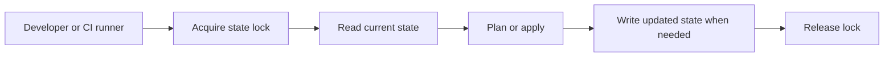

## Why state exists

A resource address such as `aws_s3_bucket.assets` is not a cloud identifier. State connects the address to the real object and records attributes Terraform needs for future operations. Two independent states managing the same object create competing owners.

Local state is convenient for a single-person lab. Team projects need shared storage, controlled access, and a supported locking mechanism.



A state lock prevents cooperating writers from updating the same state simultaneously. It does not block console changes or another state managing the same cloud object.

## Configure S3 with native locking

First create a dedicated backend bucket through a separate bootstrap process. Enable versioning, encryption, and public-access protection. Do not use the application bucket from lesson 5 as its own backend storage.

In the application root:

```hcl
terraform {
  backend "s3" {
    bucket       = "replace-with-your-existing-state-bucket"
    key          = "academy/dev/storage.tfstate"
    region       = "us-east-1"
    encrypt      = true
    use_lockfile = true
  }
}
```

Native S3 locking is available in Terraform 1.10 and later. The course's 1.11 baseline includes it. Current HashiCorp documentation marks DynamoDB-based locking as deprecated; use native S3 locking for these new examples. See the [S3 backend reference](https://developer.hashicorp.com/terraform/language/backend/s3).

Backend configuration cannot reference input variables, locals, or resource attributes. It initializes before ordinary configuration evaluation. Use partial configuration and `terraform init -backend-config=dev.backend.hcl` to supply environment-specific, nonsecret settings if needed.

## Migrate existing state

Pause other writers, confirm the source state and target key, make a protected backup, add the backend block, then run:

```bash
terraform init -migrate-state
terraform state list
terraform plan
```

Review the migration prompts. The post-migration plan should not unexpectedly recreate infrastructure. `-reconfigure` reinitializes configuration without migrating existing state; it is not a replacement for `-migrate-state`.

## Permissions and recovery

The runner needs bucket listing permission and read/write access to its state object. Native locking additionally needs read, write, and delete permissions on the `.tflock` object. Scope access to the intended state prefix. If using a customer-managed KMS key, grant the required key permissions as well.

Restrict state access because state may include secrets. Enable versioning for recovery, keep audit logs, and protect the backend from routine application cleanup. Avoid writing credentials into backend arguments, which may be persisted locally or in saved artifacts.

If a lock remains after a crashed runner, first confirm no operation is running. Only then consider `terraform force-unlock LOCK_ID`. Removing an active lock can corrupt state.

**Practice:** draw which IAM permissions a dev runner and a prod runner each need. Explain why lock-object deletion can be allowed without allowing state-object deletion.
