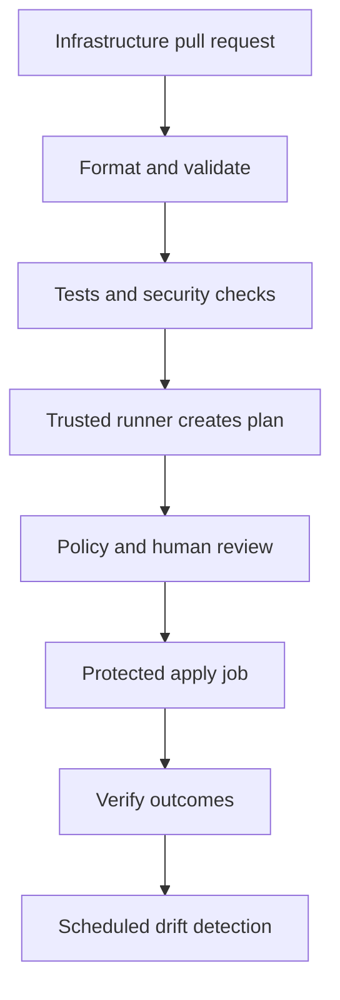

## A useful delivery sequence



Choose one state owner and one serialized apply path per root. Two jobs writing the same state should not race; use both backend locking and CI concurrency controls.

## Commands for a trusted plan job

This shell sequence assumes a configured backend, trusted source checkout, and short-lived credentials supplied by the CI platform:

```bash
set -euo pipefail
terraform init -input=false -lockfile=readonly
terraform fmt -check -recursive
terraform validate
terraform test
terraform plan -input=false -lock-timeout=5m -out=reviewed.tfplan
terraform show -no-color reviewed.tfplan
```

Use `-lockfile=readonly` in CI after committing a reviewed lock file. If providers cannot satisfy that lock file, fail the run rather than silently changing dependencies. Pin the CLI and runner tooling to reviewed versions.

The test command assumes a maintained test suite and safe test credentials. Tests using apply can create resources, so isolate them from production permissions.

## Apply the approved artifact

A protected job uses the same source revision, compatible Terraform/provider tooling, target root, and environment:

```bash
terraform init -input=false -lockfile=readonly
terraform apply -input=false -lock-timeout=5m reviewed.tfplan
```

The saved plan is the reviewed artifact. Applying it does not prompt for approval, so the CI environment approval is the actual gate. Store the artifact privately and check its association with the commit and target state before use.

If the plan becomes stale after another state-changing apply, create a new plan and review it. A saved plan also is not a guarantee that external systems have stayed unchanged during a long approval delay; refresh planning when circumstances change.

## Avoid privileged untrusted code

Pull requests from untrusted forks should not receive cloud credentials or state access. Formatting can run with limited permissions. Privileged planning should use a trusted workflow and reviewed code. Do not turn a pull-request title or comment into executable shell commands.

Use OIDC federation and protected environments. Limit who can download plan artifacts and trigger apply. Avoid posting complete plans containing secret material into public PR comments.

## Detect drift

```bash
terraform plan -detailed-exitcode -input=false
```

Exit code `0` means no changes, `1` means an error, and `2` means changes exist. Configure the scheduler to handle `2` as a drift signal rather than an execution failure. Alert an owner and review the differences before deciding whether to restore code's desired state or adopt an intentional change.

HCP Terraform can provide managed runs, state, approvals, and policy integrations. If using a hosted execution platform, follow its supported workflow rather than independently applying the same state from laptops.

**Exercise:** design a pipeline where a dev change deploys automatically after checks, while a production change requires an environment approver. Identify where the plan artifact, credentials, and state live.

Further reading: [Terraform in automation](https://developer.hashicorp.com/terraform/tutorials/automation/automate-terraform), [HCP Terraform](https://developer.hashicorp.com/terraform/cloud-docs).
