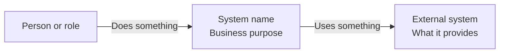
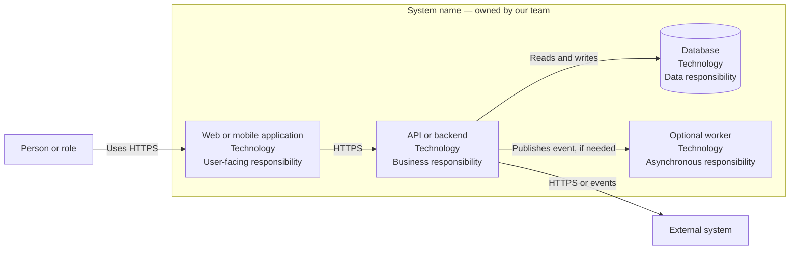
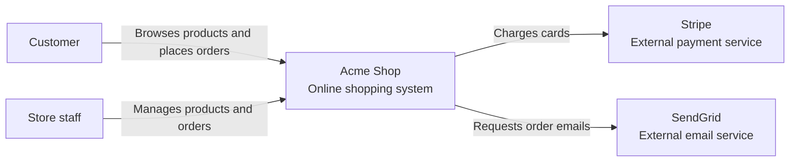
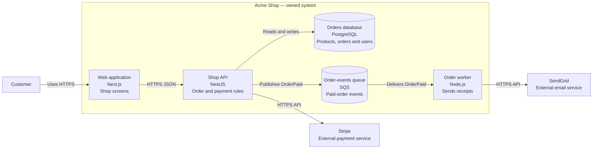

# C4 system-context and container diagrams

This is the team reference for documenting a system at the first two C4 levels. It is intentionally small: it should be easy to update in the same pull request as an architecture change.

For the teaching version, see the [C4 Context and Container Diagrams lesson](/learn/software-architecture/c4-context-and-container-diagrams).

## What each diagram is for

| Diagram | Audience | Show | Do not show |
| --- | --- | --- | --- |
| System context | Product, developers, partners, new team members | People, one system boundary, external software systems, meaningful relationships | Internal applications, databases, endpoints, classes, infrastructure details |
| Container | Developers, operations, security reviewers | Major applications, databases, queues, workers, responsibilities and important protocols | Tables, topics, classes, functions, Pods, every library |

In C4, a **container** is a separately running or separately deployable responsibility. It is not automatically a Docker container.

## Required writing rules

- Give the system a business purpose, not only a technical name.
- Give every arrow a verb or useful label: `places orders`, `HTTPS JSON`, `publishes OrderPaid`.
- Keep software owned by another organisation outside the system boundary.
- Name the technology only when it helps a reader make an architectural decision.
- Start with five to ten boxes. Split a diagram when it no longer fits on one screen or needs a paragraph to explain.
- Use the same people, external systems and ownership boundary in both diagrams. The container view only expands the system box.

## Authoring workflow

1. State the scope in one sentence: "[System] lets [people] do [outcome]."
2. List people and external software systems. Mark which systems the team owns.
3. Draw the system-context view and ask a product or support teammate to read it aloud.
4. List major deployables and data stores inside the owned system boundary.
5. Draw the container view and trace a real journey, such as "customer places an order."
6. Put the source beside the system it describes, review it with the implementation change, and update it when boundaries or integrations change.

## Mermaid templates

### System context

### Container view

## Worked example: Acme Shop

### Scope

Acme Shop lets customers buy products online and lets store staff manage the catalogue and orders.

### System context

### Container diagram

## Pull-request checklist

Use this checklist when the system boundary, an integration or a major deployable changes.

- [ ] The system purpose and owner are clear.
- [ ] Every user and external integration affected by the change is present in the context diagram.
- [ ] External systems remain outside the owned-system boundary.
- [ ] The container diagram names every major deployable, database, queue and worker affected by the change.
- [ ] Arrows explain why systems communicate and name a protocol or event where useful.
- [ ] One real request or event journey can be followed from start to finish.
- [ ] The diagram contains no credentials, private URLs, customer data or environment-specific secrets.
- [ ] The diagrams are updated in the same pull request as the architecture change.

## When these diagrams are not enough

Create a **component diagram** when a container has several important modules and a developer needs to understand their responsibilities. Use sequence diagrams for time-ordered flows such as checkout, password reset or retry behaviour. Use an ADR for a decision and its trade-offs; a diagram shows structure, but it does not preserve *why* the choice was made.
